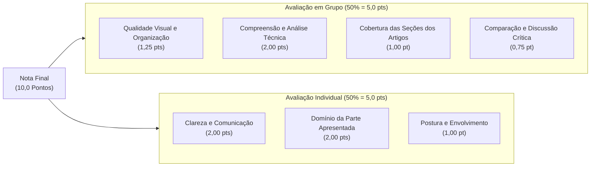

# 01. Visão Geral, Regras e Rubricas de Avaliação
## Disciplina: Tópicos Especiais em Visão Computacional (2026.2)
**Instituição:** Universidade Federal do Piauí (UFPI) – Campus Senador Helvídio Nunes de Barros (CSHNB) – Picos  
**Curso:** Bacharelado em Sistemas de Informação (6º Período)  
**Docente:** Prof. Dr. José Denes Lima Araújo (`jose.denes@ufpi.edu.br`)  
**Equipe:** Grupo 4 (3 Integrantes)  
**Valor Total:** 10,0 Pontos (50% Coletivo + 50% Individual)

---

## 1. Diretrizes Oficiais e Enquadramento da Atividade

A atividade avaliativa consiste na **pesquisa, desconstrução analítica, comparação metodológica e apresentação oral crítica** de no mínimo 2 artigos científicos completos publicados nos últimos 5 anos (2022 a 2026) nos principais congressos nacionais da **Sociedade Brasileira de Computação (SBC)** na área de Processamento de Imagens e Visão Computacional.

### 1.1. Congressos Elegíveis da SBC
- **BRACIS** (*Brazilian Conference on Intelligent Systems*)
- **SIBGRAPI** (*Conference on Graphics, Patterns and Images*)
- **SBCAS** (*Simpósio Brasileiro de Computação Aplicada à Saúde*)
- **SEMISH** (*Seminário Integrado de Software e Hardware*)
- **ENIAC** (*Encontro Nacional de Inteligência Artificial e Computacional*)

### 1.2. Conformidade dos Artigos Selecionados pelo Grupo 4

| Requisito do Edital | Artigo 1 (UFCSPA) | Artigo 2 (PUC Minas / UFMG) | Status de Conformidade |
| :--- | :--- | :--- | :--- |
| **Evento Científico** | BRACIS 2023 (SBC) | Anais de Evento SBC (2025) | :white_check_mark: Cumprido (Ambos SBC) |
| **Janela Temporal** | Publicado em 2023 | Publicado em 2025 | :white_check_mark: Cumprido (Janela 2022–2026) |
| **Categoria do Trabalho** | Trabalho Completo (*Full Paper*) | Trabalho Completo (*Full Paper*) | :white_check_mark: Cumprido (Nenhum resumo/andamento) |
| **Problema Tratado** | Classificação em MRI (Tumor Cerebral) | Classificação em Citologia (Câncer Colo Útero) | :white_check_mark: Cumprido (Problemas de Classificação) |
| **Origem Institucional** | UFCSPA (Porto Alegre - RS) | PUC Minas e UFMG (Belo Horizonte - MG) | :white_check_mark: Cumprido (Instituições e autores distintos) |

> [!IMPORTANT]
> **Planilha de Reserva de Artigos:**  
> Os artigos devem estar devidamente registrados na planilha oficial da disciplina para garantir a exclusividade do tema frente aos demais grupos:  
> [Planilha de Controle de Artigos](https://docs.google.com/spreadsheets/d/1r_5m20UooTXcWfJaHIOQVoGQpUBHZjsO/edit?usp=sharing&ouid=117216809533715838631&rtpof=true&sd=true)

---

## 2. Rubricas e Critérios Detalhados de Avaliação (10,0 Pontos)

A nota final é composta por duas notas independentes de 5,0 pontos cada: a **Avaliação em Grupo** e a **Avaliação Individual**.

### 2.1. Avaliação Coletiva (Grupo) – 5,0 Pontos

| Critério | Peso | Descrição Operacional e O que o Professor Avalia | Estratégia do Grupo 4 para Nota Máxima |
| :--- | :---: | :--- | :--- |
| **Organização, clareza e qualidade visual da apresentação** | **1,25** | Slides com formatação profissional, limpos, alto contraste, tipografia legível, equilíbrio texto/figura, fluxogramas claros e encadeamento lógico sequencial (Introdução $\to$ Metodologia $\to$ Experimentos $\to$ Resultados $\to$ Conclusão). | Utilizar padrão visual dark/light limpo, diagramas arquiteturais em alta resolução, destaques coloridos para métricas e ausência de blocos densos de texto. |
| **Compreensão e análise técnica dos artigos** | **2,00** | Domínio aprofundado dos problemas de classificação, fundamentos matemáticos das arquiteturas (CNN vs ViT), pré-processamento de dados, hiperparâmetros, funções de perda, regularizações e interpretação de matrizes de confusão. | Explicar com exatidão parâmetros de camadas, pesos de classe, mecanismos de atenção, embeddings e validação cruzada 5-fold. |
| **Cobertura adequada das seções dos artigos** | **1,00** | Apresentação balanceada que contempla todas as seções canônicas: Introdução/Motivação clínica, Trabalhos Relacionados, Metodologia/Arquitetura, Experimentos/Datasets, Resultados e Conclusões. | Alocar seções explícitas nos slides para Trabalhos Relacionados e Conclusões de cada artigo, sem omitir detalhes experimentais. |
| **Capacidade de comparação e discussão crítica** | **0,75** | Capacidade de confrontar abordagens, analisar trade-offs computacionais e estatísticos, explicar por que uma arquitetura superou outra e apontar limitações reais dos experimentos. | Sessão dedicada de confronto: viés indutivo de localidade da CNN vs *data-hunger* do ViT, e análise da sobreposição espacial de patches. |

### 2.2. Avaliação Individual – 5,0 Pontos

| Critério | Peso | O que o Professor Avalia | Comportamento Exigido |
| :--- | :---: | :--- | :--- |
| **Clareza e comunicação** | **2,00** | Dicção clara, ritmo de fala controlado, uso de vocabulário técnico correto da área de Visão Computacional, capacidade de síntese e facilidade de transmissão didática. | Evitar gírias e hesitações; articular termos com precisão: *feature maps*, convoluções, *backpropagation*, *self-attention*, *patch embeddings*, Grad-CAM. |
| **Domínio da parte apresentada** | **2,00** | Demonstração inequívoca de domínio dos conceitos da sua seção, respondendo prontamente a interrupções ou questionamentos do professor sem recorrer à leitura de notas. | Dominar não apenas o slide apresentado, mas todo o embasamento teórico e experimental que o sustenta. |
| **Participação, postura e envolvimento** | **1,00** | Postura profissional em chamada online, câmera ligada com boa iluminação, atenção contínua enquanto os colegas falam, apoio em transições de slides e espírito de equipe. | Manter câmera ativa, transições naturais sem silêncios constrangedores ("passo agora a palavra ao colega...") e prontidão mútua. |

---

## 3. Cronograma Oficial e Regras de Apresentação

### 3.1. Calendário de Bancas Online
- **09/11 (Segunda-feira):** Grupos 1, 3 e **Grupo 4** (Nossa Apresentação)
- **12/11 (Quinta-feira):** Grupos 5 e 6
- **16/11 (Segunda-feira):** Grupos 8 e 9

> [!WARNING]
> **Ordem e Modalidade:**  
> As apresentações ocorrerão de forma estritamente online, respeitando a ordem numérica dos grupos. O Grupo 4 será o terceiro a apresentar na sessão de 09/11.

### 3.2. Regra Rigorosa de Tempo
- **Janela Permitida:** Entre **30 minutos (mínimo)** e **40 minutos (máximo)**.
- **Penalidade:** Apresentações com menos de 30 minutos sofrem penalidade direta por falta de profundidade; apresentações que ultrapassarem 40 minutos serão interrompidas pelo docente, prejudicando os critérios de cobertura e síntese.
- **Divisão Interna Sugerida (3 Integrantes):**
  - **Abertura e Integrante 1 (Artigo 1 - CNN):** 11 a 12 minutos
  - **Integrante 2 (Artigo 2 - ViT Patches Dinâmicos):** 11 a 12 minutos
  - **Integrante 3 (Análise Comparativa, Discussão Crítica e Conclusão):** 11 a 12 minutos
  - **Perguntas da Banca (Prof. Denes):** 5 a 10 minutos adicionais ao final

### 3.3. Cláusulas de Presença e Contingência
1. **Obrigatoriedade de Assistir Outros Grupos:**  
   > [!CAUTION]
   > A ausência não justificada em qualquer dia de apresentação de outros grupos acarreta **perda imediata de 0,5 ponto (-0,5)** por falta na nota final da disciplina.
2. **Ausência de Integrante do Grupo:**  
   Caso um integrante do Grupo 4 sofra imprevisto de força maior no dia da apresentação, **os integrantes presentes têm a obrigação de assumir e apresentar integralmente a parte do ausente**, mantendo o tempo e a coerência do trabalho. O integrante ausente será avaliado sob critérios institucionais de justificativa junto à coordenação.
3. **Entrega de Material:**  
   Envio dos slides (PDF e PPTX) via SIGAA ou conforme orientação do docente até o início da aula de 09/11.
