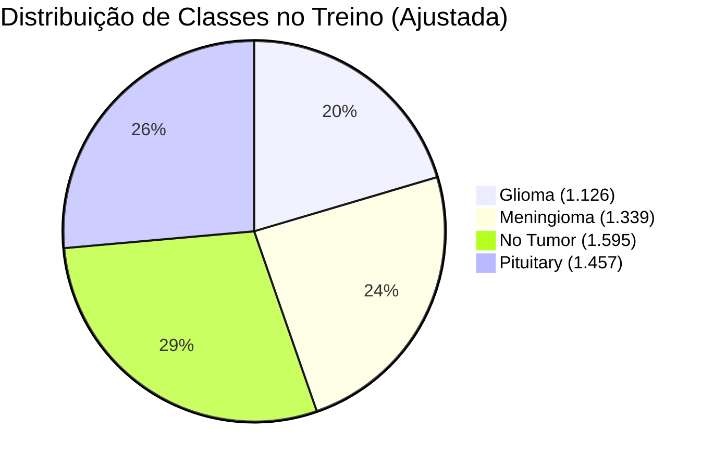
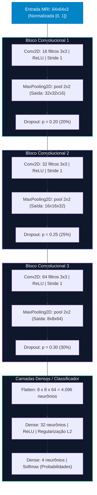

# 02. Análise Profunda do Artigo 1: Classificação de Tumores Cerebrais via CNN
## *An Approach in Brain Tumor Classification: The Development of a New Convolutional Neural Network Model*

---

### Metadados da Obra
- **Autores:** Caio dos Santos Felipe, Thatiane Alves Pianoschi Alva, Ana Trindade Winck, Carla Diniz Lopes Becker.
- **Vínculo Institucional:** Universidade Federal de Ciências da Saúde de Porto Alegre (UFCSPA) – Porto Alegre, RS, Brasil.
- **Veículo de Publicação:** Anais da SBC / *Brazilian Conference on Intelligent Systems* (BRACIS 2023) – Trilha de Computação Aplicada / Inteligência Artificial.
- **Repositório do Código:** [Repositório Aberto do Projeto (Anonymous GitHub)](https://anonymous.4open.science/r/brain-tumor-cnn-C44F/)
- **Problema Central:** Classificação multiclasse de lesões tumorais encefálicas em imagens de Ressonância Magnética (MRI) axial/coronal/sagital em 4 classes diagnósticas.

---

## 1. Contexto Clínico e Motivação Científica

Os tumores do sistema nervoso central representam uma das patologias mais letais e de diagnóstico mais complexo na neuro-oncologia. A classificação acurada do tipo histológico do tumor no momento do exame inicial de imagem é vital para:
1. **Definição da conduta terapêutica imediata:** Ressecção cirúrgica com margem de segurança vs. biópsia estereotáxica vs. radiocirurgia/quimioterapia adjuvante.
2. **Prognóstico e sobrevida:** O prognóstico varia drasticamente entre um glioma de alto grau (ex: glioblastoma multiforme, altamente infiltrativo e fatal) e um meningioma (frequentemente benigno, de crescimento extra-axial lento).
3. **Variabilidade interobservador:** A análise manual de dezenas de fatias de ressonância magnética (MRI) por radiologistas demanda tempo elevado e apresenta taxa significativa de discordância interprofissional, especialmente em centros de saúde de média e baixa complexidade.

### As 4 Classes Diagnósticas Abordadas
- **Glioma (Classe 0):** Neoplasias com origem nas células gliais (astrócitos, oligodendrócitos). Possuem margens difusas, comportamento infiltrativo e necessitam de intervenção rápida.
- **Meningioma (Classe 1):** Tumores originários das meninges (membranas protetoras do cérebro e medula). Apresentam-se geralmente bem delimitados e com inserção dural ("cauda dural").
- **No Tumor / Normal (Classe 2):** Cortes encefálicos sem evidência radiológica de massas patológicas, essenciais para evitar falsos-positivos na triagem clínica.
- **Pituitary / Adenoma de Hipófise (Classe 3):** Lesões originárias da glândula hipófise na região da sela túrcica, com repercussões endócrinas e compressivas sobre o quiasma óptico.

---

## 2. Dataset, Auditoria Crítica e Pré-Processamento

### 2.1. A Base de Dados Original vs. Auditoria dos Autores
O estudo utilizou originalmente o popular benchmark público **Brain Tumor MRI Dataset** (curado por Sartaj Bhuvaji e disponibilizado por Masoud Nickparvar no Kaggle), composto por 7.023 imagens fatiadas em dois diretórios:
- Diretório de Treinamento: 5.712 imagens
- Diretório de Teste: 1.311 imagens

> [!CAUTION]
> **A Descoberta Crítica de Rótulos Incorretos (*Label Noise*):**  
> Durante a etapa de inspeção exploratória visual, os autores da UFCSPA identificaram que a pasta da classe **Glioma** continha diversas imagens erroneamente rotuladas (incluindo meningiomas evidentes e amostras sem lesão).
> Para evitar o treinamento contaminado por *label noise*, os autores executaram uma **substituição cirúrgica das amostras incorretas** utilizando dados fidedignos e auditados do dataset **Figshare Brain Tumor Classification** (desenvolvido por Cheng et al.).

### 2.2. Distribuição Final e Particionamento
Após a substituição e a higienização da base, o dataset de trabalho foi reorganizado em:
- **Conjunto de Treinamento e Validação Interna:** 5.531 imagens
  - *Glioma:* 1.126 imagens (20,41%)
  - *Meningioma:* 1.339 imagens (24,27%)
  - *No Tumor:* 1.595 imagens (28,91%)
  - *Pituitary:* 1.457 imagens (26,41%)
- **Conjunto de Teste Independente:** 1.297 a 1.311 imagens mantidas isoladas para avaliação cega final.
- **Validação Interna:** 20% do particionamento de treino foi alocado para monitoramento de convergência durante as épocas.

### 2.3. Pipeline de Pré-Processamento Matemático
1. **Redimensionamento Espacial:** Todas as fatias de MRI foram reamostradas para uma matriz fixa de $64 \times 64$ pixels. A escolha do tamanho compacto visou reduzir exponencialmente a contagem de parâmetros treináveis, permitindo treinamento ágil sem gargalos computacionais.
2. **Normalização Min-Max:** Os valores de intensidade de pixel $[0, 255]$ foram convertidos para ponto flutuante no intervalo $[0.0, 1.0]$:
   $$I_{\text{norm}}(x, y) = \frac{I(x, y)}{255.0}$$
3. **Mapeamento Categórico:** Conversão de rótulos nominais em índices inteiros $\{0, 1, 2, 3\}$.
4. **Ponderação de Classes (*Class Weighting*):** Para compensar o desbalanceamento intrínseco (Glioma com 20,41% vs No Tumor com 28,91%), os autores calcularam e injetaram pesos inversamente proporcionais diretamente na função de perda:
   - $w_{\text{glioma}} = 1.21$
   - $w_{\text{meningioma}} = 1.03$
   - $w_{\text{notumor}} = 0.86$
   - $w_{\text{pituitary}} = 0.94$
5. **Prevenção de *Data Leakage*:** A divisão entre conjuntos foi realizada previamente à etapa de normalização e transformação dos lotes, assegurando que estatísticas do conjunto de teste não contaminassem o treinamento.
6. **Embaralhamento Contínuo (*Data Shuffling*):** A ordem das amostras foi reembaralhada a cada época em todas as dobras de validação, mitigando vícios de sequência nos gradientes estocásticos.

---

## 3. Arquitetura da Rede Neural Convolucional

A arquitetura proposta pelos pesquisadores da UFCSPA foi concebida a partir de uma reformulação adaptada e compactada dos princípios clássicos da **AlexNet** (Krizhevsky et al., 2012), substituindo filtros volumosos por uma estrutura modular profunda, regularizada e estritamente calibrada para imagens $64 \times 64$.

### 3.1. Especificação Detalhada das Camadas

| Camada / Operação | Detalhamento Técnico | Mapa de Ativação / Dimensão | Parâmetros e Regularização |
| :--- | :--- | :---: | :--- |
| **Entrada** | Matriz de intensidades tridimensional | $64 \times 64 \times 3$ | Imagens normalizadas $[0, 1]$ |
| **Conv2D 1** | 16 kernels $3 \times 3$, ativação ReLU | $62 \times 62 \times 16$ | Extração de bordas e contrastes básicos |
| **MaxPool 1** | Janela de pooling $2 \times 2$, stride 2 | $31 \times 31 \times 16$ | Redução dimensional |
| **Dropout 1** | Desligamento estocástico de neurônios | $31 \times 31 \times 16$ | Taxa de descarte: **20%** ($p = 0.20$) |
| **Conv2D 2** | 32 kernels $3 \times 3$, ativação ReLU | $29 \times 29 \times 32$ | Extração de texturas intermediárias |
| **MaxPool 2** | Janela de pooling $2 \times 2$, stride 2 | $14 \times 14 \times 32$ | Redução dimensional |
| **Dropout 2** | Desligamento estocástico de neurônios | $14 \times 14 \times 32$ | Taxa de descarte: **25%** ($p = 0.25$) |
| **Conv2D 3** | 64 kernels $3 \times 3$, ativação ReLU | $12 \times 12 \times 64$ | Detecção de padrões tumorais complexos |
| **MaxPool 3** | Janela de pooling $2 \times 2$, stride 2 | $6 \times 6 \times 64$ | Redução dimensional final |
| **Dropout 3** | Desligamento estocástico de neurônios | $6 \times 6 \times 64$ | Taxa de descarte progressiva: **30%** ($p = 0.30$) |
| **Flatten** | Vetorização linear dos mapas | $2.304$ a $4.096$ unidades | Transição convolução $\to$ denso |
| **Dense 1** | Camada oculta totalmente conectada | $32$ neurônios | Ativação ReLU + **Penalização $L_2$** |
| **Dense 2 (Saída)** | Camada de decisão multiclasse | $4$ neurônios | **Softmax** $\to P(y = c \mid x)$ |

> [!NOTE]
> **Estratégia de Regularização Progressiva:**  
> A rede adota um perfil de Dropout progressivo ($20\% \to 25\% \to 30\%$). Nas camadas convolucionais iniciais, um descarte menor (20%) preserva feições morfológicas primárias; nas camadas mais profundas, descartes maiores (30%) somados à penalidade $L_2$ nos neurônios densos coíbem a coadaptação de pesos (*overfitting*), essencial ao treinar sem um volume massivo de imagens.

---

## 4. Estratégia de Treinamento e Protocolo Experimental

### 4.1. Hiperparâmetros de Treinamento
- **Otimizador:** Adam (*Adaptive Moment Estimation*), combinando as vantagens de gradientes com momento e convergência rápida com RMSProp.
- **Função de Perda:** *Sparse Categorical Cross-Entropy*, ideal para alvos inteiros com classes mutuamente exclusivas e integrando os pesos de classe:
  $$\mathcal{L} = - \sum_{i=1}^{N} w_{y_i} \cdot \log\left(\hat{p}_{y_i}\right)$$
- **Tamanho do Lote (*Batch Size*):** 32 imagens por iteração.
- **Número Máximo de Épocas:** 60 épocas por iteração de validação cruzada.

### 4.2. Validação Cruzada K-Fold ($K = 5$)
Para garantir blindagem estatística e afastar a dependência de uma divisão arbitrária de treino/validação, o modelo foi treinado sob um esquema de **5-Fold Cross Validation**:
- Os dados de treino (5.531 amostras) foram particionados em 5 subconjuntos estratificados disjuntos.
- Em cada uma das 5 rodadas, 4 dobras (80%) foram utilizadas para calibrar os gradientes e 1 dobra (20%) foi usada para validação independente.
- Os resultados reportados de convergência e perda representam a consolidação estável das 5 dobras.

### 4.3. Sistema de Callbacks Inteligentes
1. **Early Stopping:** Monitoramento da perda no conjunto de validação com paciência configurada em **18 épocas**. Caso a perda de validação não demonstrasse declínio após 18 épocas consecutivas, o treinamento era finalizado preventivamente para evitar superajuste.
2. **Learning Rate Scheduler (*ReduceLROnPlateau*):** Caso a perda de validação se mantivesse estagnada por **5 épocas**, o otimizador aplicava um fator de redução de $0.2$ ($\text{learning\_rate} \leftarrow \text{learning\_rate} \times 0.2$), refinando o ajuste fino nos vales da superfície de erro.
3. **Model Checkpoint:** Gravação contínua em disco apenas do estado de pesos sinápticos que alcançasse o menor valor histórico de função de perda de validação.

---

## 5. Resultados Experimentais e Métricas de Desempenho

A avaliação final do modelo foi conduzida no conjunto de teste independente (composto por 1.311 imagens não vistas durante as 5 dobras de treinamento).

### 5.1. Relatório de Classificação Detalhado

| Classe Diagnosticada | Precisão (*Precision*) | Revocação (*Recall*) | F1-Score | Suporte de Teste (*Imagens*) |
| :--- | :---: | :---: | :---: | :---: |
| **Glioma** | **1,00** (100%) | **1,00** (100%) | **1,00** | 286 |
| **Meningioma** | **0,98** (98%) | **0,97** (97%) | **0,98** | 306 |
| **No Tumor (Normal)** | **0,99** (99%) | **1,00** (100%) | **0,99** | 405 |
| **Pituitary (Hipófise)** | **0,99** (99%) | **0,99** (99%) | **0,99** | 300 |
| **Acurácia Global** | — | — | **0,99** (99,0%) | **1.311** |
| **Média Macro (*Macro Avg*)** | 0,99 | 0,99 | 0,99 | 1.311 |
| **Média Ponderada (*Weighted Avg*)** | 0,99 | 0,99 | 0,99 | 1.311 |

> [!TIP]
> **Destaque Clínico do Resultado:**  
> A revocação de **1,00 (100%)** obtida na classe *Glioma* é de valor clínico inestimável: significa que o modelo **não produziu nenhum falso-negativo para glioma** em um conjunto de 286 pacientes. Sendo o glioma o tumor mais letal do grupo, classificar erroneamente um glioma como "sem tumor" ou "meningioma" seria catastrófico em termos de prognóstico.

### 5.2. Curvas de Aprendizado e ROC/AUC
- As curvas de convergência demonstraram estabilização da perda de treino e validação entre a 25ª e a 35ª época.
- A área sob a curva ROC (*Area Under the Receiver Operating Characteristic* - AUC-ROC) situou-se próxima de **1,0** para todas as classes, confirmando alto poder discriminativo em múltiplos limiares de sensibilidade/especificidade.

---

## 6. Explicabilidade (XAI) com Grad-CAM

Em aplicações biomédicas de inteligência artificial, o paradigma da "caixa-preta" (*black-box*) é inaceitável para adoção clínica real. Radiologistas necessitam verificar se o algoritmo tomou sua decisão fundamentado no sinal anátomo-patológico da lesão e não em artefatos de borda, ossos cranianos ou marcas de texto do aparelho de ressonância.

### 6.1. Formulação Matemática do Grad-CAM
Os autores incorporaram o **Gradient-weighted Class Activation Mapping (Grad-CAM)** (Selvaraju et al., adaptado metodologicamente por Chollet):
1. Calcula-se o gradiente da pontuação da classe vencedora $y^c$ em relação a cada elemento $A_{i,j}^k$ do $k$-ésimo mapa de ativação convolucional da terceira camada:
   $$\alpha_k^c = \frac{1}{Z} \sum_{i} \sum_{j} \frac{\partial y^c}{\partial A_{i,j}^k}$$
2. Realiza-se a combinação linear ponderada dos mapas de feição com aplicação da função retificadora linear ($\text{ReLU}$), retendo exclusivamente os padrões com influência positiva no diagnóstico da classe $c$:
   $$L_{\text{Grad-CAM}}^c = \text{ReLU}\left( \sum_{k} \alpha_k^c \cdot A^k \right)$$
3. O mapa de calor bidimensional gerado é interpolado bilinearmente de volta à resolução original e sobreposto à imagem de ressonância em escala pseudo-colorida (*jet/rainbow*).

### 6.2. Auditoria e Validação Externa dos Mapas de Calor
- **Inspeção no Conjunto de Teste:** Os mapas Grad-CAM gerados evidenciaram concentrações térmicas (zonas vermelhas/amarelas) perfeitamente coincidentes com a massa tumoral contrastada e o edema peritumoral, descartando ativações espúrias em regiões anatômicas sadias.
- **Validação Cruzada em Dataset Externo Inédito:** Para ratificar que a explicabilidade não estava sofrendo de sobreajuste local, os autores selecionaram fatias aleatórias de um repositório externo completamente inédito (*Brain Tumor Classification (MRI)* - Kaggle). A rede convolucional manteve a ativação espacial localizada exatamente sobre o epicentro da lesão de meningioma, comprovando robustez clínica de generalização.

---

## 7. Discussão Crítica: Pontos Fortes e Limitações

### Pontos Fortes
- **Rigor Metodológico no Dataset:** Auditoria manual de imagens que identificou e substituiu rótulos incorretos no Kaggle com o Figshare, evitando aprendizado de ruído.
- **Eficiência Computacional Extrema:** Modelo enxuto com apenas 3 blocos convolucionais e classificação em $64 \times 64$, dispensando infraestruturas de supercomputação e permitindo inferência quase instantânea.
- **Regularização Bem Planejada:** Uso conjunto de Dropout escalonado ($20\% \to 25\% \to 30\%$), decaimento de pesos $L_2$ e ponderação de perda para desbalanceamento.
- **Explicabilidade Prática:** Validação visual transparente com Grad-CAM inclusive em bases externas.

### Limitações e Desafios
- **Resolução Reduzida ($64 \times 64$):** Embora eficiente, o downsampling para $64 \times 64$ descarta detalhes finos de microvascularização tumoral e sutilezas de limites infiltrativos de gliomas difusos.
- **Ausência de *Data Augmentation* Online Massivo:** O artigo não reporta o uso extensivo de transformações elásticas afins, distorções de contraste ou rotações aleatórias durante os batches de treino.
- **Potencial *Slice Leakage*:** Como é comum em datasets públicos de ressonância 2D no Kaggle, cortes anatômicos adjacentes de um mesmo paciente podem ter sido particionados simultaneamente no treino e no teste se a curadoria original não tiver fornecido os identificadores únicos de paciente (*patient-level split*).
