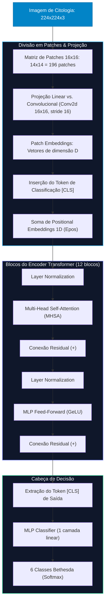
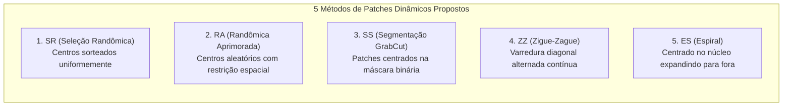

# 03. Análise Profunda do Artigo 2: Vision Transformers com Patches Dinâmicos
## *Vision Transformers com Patches Dinâmicos para a Análise de Lâminas Histológicas*

---

### Metadados da Obra
- **Autores:** Vinícius Henrique Giovanini <sup>1</sup>, Alexei Manso Correa Machado <sup>1, 2</sup>.
- **Vínculos Institucionais:**  
  1. Departamento de Ciência da Computação – Pontifícia Universidade Católica de Minas Gerais (PUC Minas), Belo Horizonte, MG, Brasil.  
  2. Departamento de Anatomia e Imagem – Faculdade de Medicina, Universidade Federal de Minas Gerais (UFMG), Belo Horizonte, MG, Brasil.
- **Veículo de Publicação:** Anais da SBC (Sociedade Brasileira de Computação) – Artigo Completo (Publicado em 2025).
- **Problema Central:** Classificação automatizada de lesões precursoras do câncer de colo de útero em imagens microscópicas de citologia cervical (exame de Papanicolau), categorizando núcleos celulares individuais em 6 classes do Sistema Bethesda através de Vision Transformers (ViT) com investigação de extração dinâmica de patches.

---

## 1. Contexto Clínico: Citologia Cervical e Sistema Bethesda

O câncer de colo uterino é a quarta neoplasia maligna mais incidente e uma das principais causas de mortalidade feminina globalmente. O exame de rastreamento citopatológico de rotina (Papanicolau) consiste na raspagem celular do epitélio cervical, fixação em lâmina, coloração e escrutínio microscópico em busca de atipias nucleares e alterações morfológicas.

### As 6 Classes Citopatológicas do Sistema Bethesda
1. **ASC-H (*Atypical Squamous Cells – cannot exclude HSIL*):** Células escamosas atípicas onde não se pode excluir uma lesão intraepitelial de alto grau; alta suspeita oncológica.
2. **ASC-US (*Atypical Squamous Cells of Undetermined Significance*):** Células escamosas atípicas de significado indeterminado; atipia nuclear limítrofe, frequentemente associada a infecção ou inflamação por HPV.
3. **HSIL (*High-Grade Squamous Intraepithelial Lesion*):** Lesão intraepitelial escamosa de alto grau; alteração pré-maligna severa com alta taxa de progressão para carcinoma invasor se não tratada.
4. **LSIL (*Low-Grade Squamous Intraepithelial Lesion*):** Lesão intraepitelial escamosa de baixo grau; proliferação celular anômala geralmente transitória associada ao efeito citopático do HPV.
5. **NFIL (*Negative for Intraepithelial Lesion or Malignancy*):** Negativo para lesão intraepitelial ou malignidade; epitélio escamoso maduro e sadio (classe majoritária de triagem).
6. **SCC (*Squamous Cell Carcinoma*):** Carcinoma de células escamosas; neoplasia epitelial maligna já invasiva que rompeu a membrana basal celular.

---

## 2. Dataset CRIC, Particionamento Anti-Leakage e Balanceamento

### 2.1. O Dataset CRIC (UFOP)
O estudo baseou-se na base pública **CRIC** (*Centro de Reconhecimento e Inspeção de Células*), desenvolvida pela Universidade Federal de Ouro Preto (UFOP).
- **Estrutura original:** 400 imagens de alta resolução de campos microscópicos reais de citologia cervical.
- **Segmentação celular:** Contém anotações delimitando **11.534 núcleos de células**, recortados em janelas de $90 \times 90$ pixels e redimensionados/alinhados para matrizes de $224 \times 224$ pixels.
- **Desbalanceamento Extremo:** Refletindo a rotina dos laboratórios de patologia, a vasta maioria dos núcleos é sadia (NFIL possui 6.779 amostras), enquanto as classes malignas raras apresentam escassez crítica (o carcinoma invasivo SCC possui apenas 161 amostras em toda a base).

### 2.2. Particionamento Estratificado por Paciente (*Patient-Level Split*)
> [!IMPORTANT]
> **Blindagem Absoluta Contra Vazamento de Dados (*Data Leakage*):**  
> Um dos grandes méritos metodológicos do artigo foi a separação dos subconjuntos **estritamente pelo código identificador de cada paciente**:
> - Treinamento: 64% das pacientes
> - Validação: 20% das pacientes
> - Teste Independente: 16% das pacientes
> 
> *Implicação Técnica:* Células ou núcleos originários de um mesmo paciente jamais aparecem simultaneamente no treino e no teste. Isso elimina vieses de background celular e coloração histológica específica da lâmina daquele indivíduo.

### 2.3. Técnica Híbrida de Balanceamento de Dados
Para combater a disparidade numérica no conjunto de treinamento sem alterar a distribuição natural dos dados de validação e teste, os autores adotaram uma estratégia de calibração em **1.000 amostras exatas por classe no treino** (totalizando 6.000 imagens):
- **Oversampling com Albumentations:** Aplicado às classes minoritárias (SCC de 103 $\to$ 1.000; ASC-US de 388 $\to$ 1.000; ASC-H de 592 $\to$ 1.000; LSIL de 871 $\to$ 1.000) por meio de transformações afins aleatórias: rotações angulares, inversões horizontais/verticais (*flips*) e cortes de enquadramento.
- **Undersampling Aleatório:** Aplicado às classes majoritárias abundantes (NFIL reduzida de 4.339 $\to$ 1.000; HSIL reduzida de 1.090 $\to$ 1.000).

```
Tabela Oficial de Distribuição de Amostras (Antes [A] e Depois [D] do Balanceamento):
+---------------------+-------+--------+-------+------+---------+-----+---------+
| Partição            | ASC-H | ASC-US | HSIL  | LSIL | NFIL    | SCC | Total   |
+---------------------+-------+--------+-------+------+---------+-----+---------+
| Treino (Antes / A)  | 592   | 388    | 1.090 | 871  | 4.339   | 103 | 7.383   |
| Treino (Depois / D) | 1.000 | 1.000  | 1.000 | 1.000| 1.000   | 1.000| 6.000  |
| Validação (Intacta) | 185   | 122    | 341   | 272  | 1.356   | 33  | 2.309   |
| Teste (Intacto)     | 148   | 96     | 272   | 217  | 1.084   | 25  | 1.842   |
+---------------------+-------+--------+-------+------+---------+-----+---------+
```

---

## 3. Fundamentos dos Vision Transformers (ViT)

Diferente das Redes Neurais Convolucionais, que processam tensores 2D mantendo a geometria espacial local através de janelas deslizantes de convolução, o **Vision Transformer (Dosovitskiy et al., 2020)** adapta a arquitetura Transformer original de Processamento de Linguagem Natural (NLP) para visão computacional.



### 3.1. Matemática da Autoatenção (Self-Attention)
Cada patch token $z_i$ projeta matrizes de Consulta ($Q$), Chave ($K$) e Valor ($V$):
$$Q = z W^Q, \quad K = z W^K, \quad V = z W^V$$
$$\text{Attention}(Q, K, V) = \text{softmax}\left(\frac{Q K^T}{\sqrt{d_k}}\right) V$$
O mecanismo calcula a correlação contextual global de cada patch contra **todos os outros 195 patches simultaneamente**, com complexidade temporal e espacial quadrática $\mathcal{O}(N^2)$, onde $N=196$.

### 3.2. Projeção Linear vs. Projeção Convolucional
- **Projeção Linear Pura:** O patch $16 \times 16 \times 3$ (768 valores) é achatado em um vetor e multiplicado por uma matriz linear $E \in \mathbb{R}^{768 \times D}$. O modelo não possui viés indutivo e precisa aprender vizinhanças locais do zero.
- **Projeção Convolucional (Conv2d):** Aplica-se uma camada convolucional 2D com kernel $16 \times 16$, *stride* de 16 pixels e $D$ canais de saída. A convolução inicial introduz uma extração suave prévia de gradientes e bordas, preservando relações topológicas locais antes da autoatenção.

---

## 4. A Proposta: 5 Métodos de Extração Dinâmica de Patches

Em biologia celular, o núcleo atípico ocupa frequentemente apenas a porção central do recorte ($90 \times 90$), deixando a periferia preenchida por citoplasma homogêneo ou fundo branco vazio da lâmina. A hipótese dos autores era de que **extrair os 196 patches de forma dinâmica e concentrada sobre a região de interesse celular aumentaria o poder discriminativo do ViT**.



### 4.1. Detalhamento de Cada Abordagem
1. **Seleção Randômica (SR):**  
   Os centros dos 196 patches são sorteados puramente de maneira uniforme dentro dos limites da imagem. Gera aglomerações e lacunas estocásticas.
2. **Randômica Aprimorada (RA):**  
   Os centros são sorteados aleatoriamente, porém impõe-se uma **distância euclidiana mínima** entre os centros vizinhos para evitar que patches colapsem uns sobre os outros com sobreposição quase idêntica.
3. **Seleção por Segmentação (SS) com GrabCut:**  
   - O algoritmo clássico de visão computacional **GrabCut** (Rother et al.) é executado para segmentar o núcleo e citoplasma, gerando uma máscara binária da célula.
   - Os centros dos 196 patches são restritos exclusivamente às coordenadas dos pixels brancos da máscara (região celular ativa).
   - *Mecanismo de Fallback:* Caso a célula seja diminuta e a máscara ocupe menos de 10% da área da imagem ($< 10\%$), o método aborta dinamicamente a segmentação e recorre à extração em grid regular convencional para evitar divisões por zero ou colapsos espaciais.
4. **Zigue-Zague (ZZ):**  
   Os centros dos patches seguem um percurso contínuo de varredura bidirecional em zigue-zague ao longo das diagonais da matriz de interesse celular.
5. **Espiral (ES):**  
   A amostragem inicia-se rigorosamente no centro geométrico da imagem (onde o núcleo se encontra posicionado por padrão no pré-processamento do CRIC) e expande-se circularmente em raios crescentes para a periferia. Concentra a máxima densidade de patches sobre o núcleo e rarefaz a amostragem no citoplasma.

---

## 5. Protocolo de Treinamento e Infraestrutura de Hardware

### 5.1. Recursos Computacionais Utilizados
- **Estação Local (PUC Minas):**  
  GPU NVIDIA GeForce RTX 2060 (6 GB de VRAM), Processador AMD Ryzen 5 3600X, 32 GB de memória RAM.  
  *Capacidade:* Suficiente para fine-tuning dos modelos **ViT-Tiny** e **ViT-Small**.
- **Nuvem (Google Colab PRO):**  
  GPU NVIDIA Tesla T4 (15 GB de VRAM), 13 GB de RAM.  
  *Capacidade:* Necessária para carregar o modelo **ViT-Base**, cujos tensores de atenção estouravam os 6 GB de VRAM local.

### 5.2. Hiperparâmetros e Ajuste Fino (*Fine-Tuning*)
- **Modelos Base:** Pré-treinados na **ImageNet-21k** (14 milhões de imagens, 21.841 classes) na resolução $224 \times 224$ com patches $16 \times 16$.
- **Taxa de Aprendizado (*Learning Rate*):** A taxa de $1 \times 10^{-4}$ resultou em oscilações severas e overfitting precoce; foi estipulada em **$1 \times 10^{-5}$** com batch size de **32**, garantindo convergência estável.
- **Regularização:** O decaimento de pesos (*weight decay*) foi testado extensivamente e descartado por não produzir ganhos estatísticos relevantes.
- **Estratégia de Descongelamento (*Unfreezing*):**
  - **ViT-Small (12 blocos de codificador):** Descongelaram-se os **2 primeiros blocos** (para aprender representações visuais de baixo nível adaptadas à citologia) e os **3 últimos blocos** (para calibrar semântica de alto nível e abstração das 6 classes), mantendo os blocos intermediários congelados.
  - **ViT-Base:** Devido à densidade de parâmetros e saturação da GPU T4, descongelou-se **apenas o último bloco MLP** do 11º codificador e a camada classificadora linear.
  - **ViT-Tiny:** Descartado nos experimentos preliminares por apresentar capacidade representativa insuficiente para os padrões nucleares.

---

## 6. Resultados Quantitativos e o "Paradoxo do Grid"

### 6.1. A Tabela Oficial de Acurácia nos Testes

```
Tabela Oficial de Resultados Finais de Acurácia no Conjunto de Teste:
+-----------+------------+------------+------------+--------------+-------------+---------+
| Modelo    | Projeção   | SR (Rand.) | RA (Aprim.)| SS (GrabCut) | ZZ (ZigueZ.)| ES (Esp)|
+-----------+------------+------------+------------+--------------+-------------+---------+
| ViT-Base  | Linear     | 0,70       | 0,65       | 0,60         | 0,67        | 0,67    |
| ViT-Small | Linear     | 0,64       | 0,70       | 0,71         | 0,68        | 0,69    |
| ViT-Small | Conv2D     | 0,75       | 0,77       | 0,76         | 0,76        | 0,78    |
+-----------+------------+------------+------------+--------------+-------------+---------+
| BASELINE SEM MODIFICAÇÃO (Grid Conv2D Regular - ViT-Small):                               |
| • Acurácia de Validação: 0,81 (81%) | • Acurácia de Teste: 0,79 (79%)                     |
+-------------------------------------------------------------------------------------------+
```

### 6.2. Análise Técnica dos Achados
1. **O Grid Conv2D Regular Venceu Todos os Métodos Dinâmicos:**  
   O modelo ViT-Small padrão, sem qualquer extração dinâmica (grid $14 \times 14$ estático uniforme), obteve **0,79 de acurácia no teste e 0,81 na validação**, superando todos os 5 métodos sofisticados de amostragem dinâmica.
2. **Entre os Dinâmicos, a Espiral Convolucional (ES) Foi Superior:**  
   A Seleção por Espiral com Conv2D atingiu **0,78**, aproximando-se do baseline por explorar a simetria centrada das células no dataset CRIC.
3. **A Convolução Salvou os Métodos Dinâmicos:**  
   Em todas as abordagens dinâmicas, a projeção convolucional superou a linear com folga (ex: no método Espiral saltou de $0,69 \to 0,78$; na Randômica Aprimorada de $0,70 \to 0,77$).
4. **O Desempenho Fraco do ViT-Base:**  
   Apesar de possuir 86 milhões de parâmetros (contra 22M do Small), o ViT-Base obteve acurácia modesta de 0,75 no teste baseline e 0,60 a 0,70 nos dinâmicos. A causa foi a impossibilidade computacional de descongelar mais camadas na GPU T4 e a insuficiência de dados para treinar uma rede tão massiva.

---

## 7. Discussão Crítica: Por Que a Proposta Não Superou o Baseline?

O trabalho de Giovanini e Machado é um exemplo clássico e valioso de **"resultado negativo na ciência"** (*negative result*), onde uma hipótese intuitivamente atraente é refutada pelo rigor experimental.

### 7.1. Causa 1: Sobreposição Espacial Excessiva (*Over-Clustering*)
Ao forçar a extração de **196 patches** dentro de uma área de interesse celular de apenas $90 \times 90$ pixels, os patches sofreram uma **taxa de sobreposição superior a 80%**.  
Em vez de prover mais informação, múltiplos patches capturaram exatamente o mesmo grupo de pixels nucleares com deslocamentos de 1 a 2 pixels. Essa redundância gerou mapas de atenção colapsados, onde a autoatenção calculava produtos escalares de vetores quase idênticos, sem adicionar ganho informacional.

### 7.2. Causa 2: Ruptura dos *Positional Embeddings* Pré-Treinados
Os pesos pré-treinados na ImageNet-21k foram aprendidos sobre uma grade cartesiana rígida $14 \times 14$. O codificador aprendeu que o patch posicional $P_1$ fica no canto superior esquerdo e $P_{196}$ no canto inferior direito.  
Ao extrair patches por GrabCut ou Espiral com coordenadas espaciais arbitrárias mas injetando os *positional embeddings* 1D fixos do Transformer, **destruiu-se a correspondência espacial geométrica aprendida na ImageNet**, forçando a rede a reajustar relações espaciais complexas sem volume de dados suficiente.

### 7.3. Causa 3: A Falta de Contexto Periférico
O grid convencional cobre a imagem inteira, incluindo o citoplasma marginal e o microambiente da lâmina. Na citopatologia Bethesda, o critério diagnóstico para diferenciar ASC-US de HSIL muitas vezes não é apenas a cromatina nuclear, mas a **relação núcleo-citoplasma (relação N/C)**. Ao concentrar todos os patches no núcleo, os métodos dinâmicos cegaram o Transformer quanto à extensão do citoplasma ao redor!

### 7.4. Por Que o Ensemble de CNNs (Diniz et al., 2021) Superou o ViT?
Na literatura recente sobre a base CRIC, o trabalho de Diniz et al. (2021) alcançou **95% de acurácia** utilizando um Ensemble de Redes Convolucionais clássicas.
- **Viés Indutivo das CNNs:** Redes convolucionais possuem campos receptivos locais, compartilhamento de pesos e invariância translacional intrínseca incorporada na própria equação matemática da convolução.
- **A Fome de Dados (*Data Hunger*) dos ViTs:** Vision Transformers tratam a imagem como uma sequência pura e não assumem a priori que pixels vizinhos estão relacionados; eles precisam **descobrir as leis do espaço visual por meio de dados massivos**. Para bases médicas com apenas 6.000 imagens de treino, uma CNN bem regularizada ainda supera com folga um ViT.
