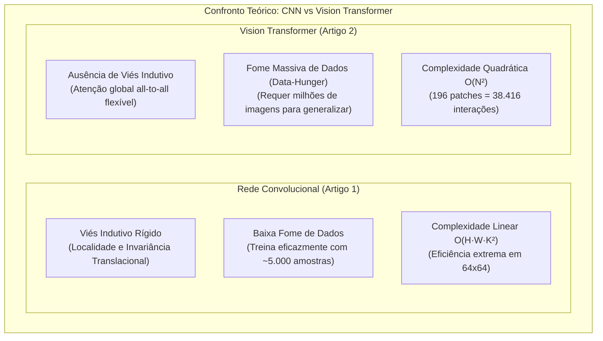
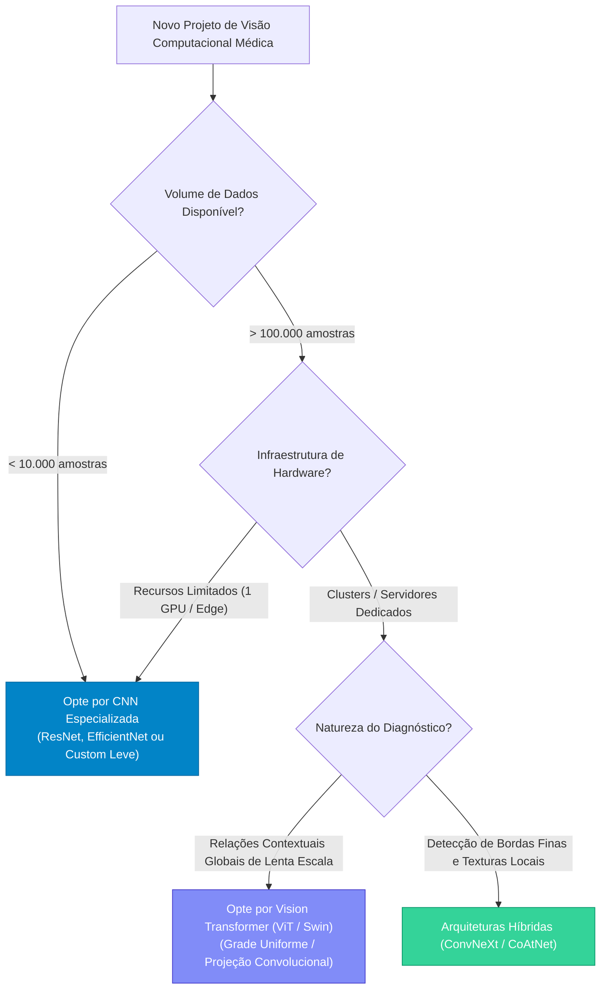

# 04. Análise Comparativa Multidimensional e Discussão Crítica
## Confronto Metodológico: CNN Leve (UFCSPA) vs. Vision Transformers Dinâmicos (PUC Minas / UFMG)

---

## 1. Matriz Comparativa Sistemática

A tabela a seguir consolida uma desconstrução analítica dos dois artigos sob **16 dimensões fundamentais** de Engenharia de Visão Computacional, Aprendizado Profundo e Aplicação Biomédica:

| Dimensão de Análise | Artigo 1: UFCSPA (BRACIS 2023) | Artigo 2: PUC Minas / UFMG (SBC 2025) |
| :--- | :--- | :--- |
| **Problema Clínico** | Diagnóstico diferencial de neoplasias encefálicas (4 classes). | Rastreamento citológico de câncer do colo do útero (6 classes). |
| **Modalidade de Imagem** | Ressonância Magnética (MRI) cerebral (fatias 2D transversais). | Citopatologia microscópica óptica de esfregaço cervical (Papanicolau). |
| **Granularidade do Alvo** | Macroestrutural: cérebro completo com massa tumoral e crânio. | Microestrutural: núcleos celulares isolados e citoplasma adjacente. |
| **Classes Diagnósticas** | 4 classes: *Glioma*, *Meningioma*, *Pituitary*, *No Tumor*. | 6 classes (Bethesda): *ASC-H*, *ASC-US*, *HSIL*, *LSIL*, *NFIL*, *SCC*. |
| **Bases de Dados Utilizadas** | Brain Tumor MRI Dataset (Kaggle) + Figshare Dataset. | Base CRIC (Centro de Reconhecimento e Inspeção de Células - UFOP). |
| **Volume de Amostras** | 7.023 imagens (5.531 treino/validação e 1.297 teste). | 11.534 núcleos celulares de 400 imagens de lâminas microscópicas. |
| **Resolução de Entrada** | $64 \times 64$ pixels (3 canais, normalizados entre 0 e 1). | $224 \times 224$ pixels (recortes nativos de $90 \times 90$ adaptados). |
| **Auditoria e Limpeza de Dados** | Identificação e substituição cirúrgica de rótulos errados de Glioma. | Segmentação morfológica e remoção de artefatos celulares acervados. |
| **Prevenção de *Data Leakage*** | Separação de partições antes da normalização e K-Fold CV. | **Estratificação estrita por paciente** (64% treino, 20% val, 16% teste). |
| **Balanceamento de Dados** | Ponderação estocástica na perda (*Class Weights*: 1.21 a 0.86). | Estratégia Híbrida: *Oversampling* (Albumentations) + *Undersampling*. |
| **Paradigma Arquitetural** | **Rede Neural Convolucional (CNN)** inspirada na AlexNet. | **Vision Transformer (ViT)** com mecanismos de Autoatenção. |
| **Origem dos Pesos** | **Treinado do Zero (*From Scratch*)** com K-Fold rigoroso. | **Fine-Tuning com Pesos Pré-Treinados** na ImageNet-21k. |
| **Extração Espacial de Entrada** | Convoluções bidimensionais globais fixas ($3 \times 3$). | Comparação entre **Grid Regular** vs **5 Métodos Dinâmicos**. |
| **Projeção de Entrada** | Operador convolucional clássico contínuo. | **Projeção Linear Pura** vs **Projeção Convolucional (Conv2D)**. |
| **Pegada Computacional** | Muito leve: 3 blocos Conv, pouca RAM, treina rápido em CPU/GPU. | Pesada: ViT-Small (RTX 2060 6GB) e ViT-Base (Nuvem Google Colab T4 15GB). |
| **Explicabilidade (XAI)** | **Grad-CAM** com validação cruzada em base externa inédita. | Rastreamento espacial e dispersão geométrica dos patches dinâmicos. |
| **Desempenho Principal** | **Acurácia Global: 99,0%** (F1 de 1.00 em Glioma). | **Acurácia Teste: 79,0%** (Baseline Grid) / **78,0%** (Espiral Conv2D). |
| **Conclusão Metodológica** | Validação de modelo leve especializado com alta confiabilidade. | **Resultado Negativo Rigoroso:** Grid superou os métodos dinâmicos. |

---

## 2. O Duelo Conceitual: Convolução vs. Autoatenção em Imagens Médicas

Para a defesa oral e pontuação máxima no critério *"Capacidade de comparação e discussão crítica" (0,75 pt)*, o grupo deve articular com maestria a diferença teórica entre os dois paradigmas computacionais.



### 2.1. O Viés Indutivo de Localidade (*Inductive Bias*)
- **Nas Redes Neurais Convolucionais (Artigo 1):**  
  A convolução possui dois pressupostos físicos embutidos em sua formulação matemática:
  1. *Localidade:* Pixels espacialmente próximos possuem forte correlação semântica (bordas, curvaturas, contrastes de tecido).
  2. *Equivariância à Translação:* Uma massa tumoral tem as mesmas características radiológicas independentemente de estar localizada no hemisfério esquerdo ou direito do cérebro.  
  Graças a esses operadores pré-definidos, o modelo da UFCSPA necessitou de poucas épocas e apenas 5.531 amostras para convergir para 99% de acurácia, aprendendo filtros de bordas e texturas sem desperdiçar capacidade representacional.

- **Nos Vision Transformers (Artigo 2):**  
  O mecanismo de autoatenção $\text{Attention}(Q, K, V) = \text{softmax}\left(\frac{QK^T}{\sqrt{d_k}}\right)V$ não assume nada sobre a geometria da imagem. O modelo enxerga uma imagem como um conjunto não ordenado de 196 tokens de patch e precisa descobrir, por força bruta de dados e retropropagação, que o patch adjacente à direita está correlacionado com o patch central. Sem um volume massivo de milhões de lâminas citológicas, a rede tem dificuldade em aprender coerência espacial fina.

### 2.2. O Fenômeno do *Data-Hunger* (Fome de Dados)
Este é o ponto fulcral da discussão:
- No Artigo 1, uma base com 5.531 imagens de treino foi **mais do que suficiente** para calibrar uma CNN de 3 blocos do zero.
- No Artigo 2, mesmo utilizando um modelo pré-treinado na gigantesca ImageNet-21k (14 milhões de imagens), o conjunto de 6.000 amostras balanceadas de citologia cervical foi **insuficiente** para permitir que o ViT superasse um clássico ensemble de CNNs (Diniz et al., 2021, que atingiu 95% na mesma base).  
- *Lição Teórica:* O pré-treino em imagens naturais (carros, cães, mesas da ImageNet) transfere pouca semântica útil para distinguir granulações finas de cromatina nuclear e mitoses celulares em coloração hematoxilina-eosina.

---

## 3. Desconstrução Crítica dos Métodos de Patches Dinâmicos

A hipótese investigada por Giovanini e Machado no Artigo 2 parecia revolucionária: se o núcleo da célula é a única região anômala, por que desperdiçar atenção em áreas de fundo branco da lâmina? Por que a extração dinâmica falhou frente ao grid estático convencional?

```
+----------------------------------------------------------------------------------------------------+
|                       ANÁLISE DE CAUSA-RAIZ: O FRACASSO DOS PATCHES DINÂMICOS                       |
+------------------------------------+---------------------------------------------------------------+
| FENÔMENO FÍSICO / MATEMÁTICO       | IMPACTO NO DESEMPENHO DO TRANSFORMER                          |
+------------------------------------+---------------------------------------------------------------+
| 1. Super-Aglomeração               | Forçar 196 patches de 16x16 em uma área de 90x90 gera         |
|    (Over-Clustering)               | sobreposição > 80%. Os vetores Q e K tornam-se quase idênticos,|
|                                    | colapsando os mapas de autoatenção em entropia redundante.    |
|                                    |                                                               |
| 2. Ruptura de Positional           | Os positional embeddings 1D foram pré-treinados para um grid   |
|    Embeddings                      | cartesiano 14x14. Coordenadas aleatórias (SR) ou espirais (ES)|
|                                    | quebram o mapa topológico aprendido na ImageNet.              |
|                                    |                                                               |
| 3. Cegueira da Relação             | No sistema Bethesda, patologistas avaliam a relação           |
|    Núcleo-Citoplasma (N/C)         | núcleo-citoplasma. Concentrar patches apenas no núcleo cega   |
|                                    | o modelo quanto ao tamanho e formato do citoplasma periférico.|
|                                    |                                                               |
| 4. O Papel Redentor da             | A projeção convolucional (Conv2d) superou a linear pura em     |
|    Convolução                      | todos os 5 métodos (+5% a +11%), pois reintroduziu viés local |
|                                    | e suavização espacial antes da atenção.                       |
+------------------------------------+---------------------------------------------------------------+
```

> [!IMPORTANT]
> **O Valor Epistemológico do "Resultado Negativo":**  
> Na literatura médica e de aprendizado de máquina, existe um vício crônico de publicação (*publication bias*) onde apenas arquiteturas que quebram recordes de acurácia são divulgadas.  
> O Artigo 2 possui **elevadíssimo mérito acadêmico** porque submeteu uma hipótese intuitiva (amostragem dinâmica concentrada) a um experimento controlado, provando matematicamente que ela deteriora a representação posicional e introduz redundância prejudicial. Esse resultado evita que centenas de outros pesquisadores desperdicem poder computacional em abordagens similares sem compensação de embeddings.

---

## 4. O Debate de Validação Metodológica: *Slice Leakage* vs. *Patient Stratification*

Um dos critérios de maior rigor para o grupo impressionar o avaliador é demonstrar capacidade de auditar criticamente os protocolos de validação de ambos os artigos:

### 4.1. A Força do Artigo 2: Blindagem Estrita por Paciente
O Artigo 2 adotou o padrão-ouro de validação em inteligência artificial médica: **nenhum paciente contribuiu com imagens para mais de um subconjunto**.  
- Se a paciente Maria teve 50 células coletadas no exame, todas as 50 ficaram ou no treino, ou na validação, ou no teste.
- *Por que isso é vital?* Cada lâmina histológica possui características únicas de pH, tempo de fixação do reagente, coloração de Papanicolau e espessura do esfregaço. Se células de Maria estivessem no treino e no teste, o modelo poderia "memorizar" a tonalidade de cor da lâmina de Maria, gerando acurácia inflada artificialmente.

### 4.2. A Vulnerabilidade Oculta do Artigo 1: Risco de *Slice Leakage*
O Artigo 1 alcançou impressionantes 99% de acurácia global e 1,00 de F1 em Glioma. Contudo, cabe ao grupo levantar uma questão metodológica madura:
- O dataset *Brain Tumor MRI Dataset* do Kaggle é composto por imagens 2D fatiadas de exames volumétricos tridimensionais de ressonância.
- Os autores dividiram os dados aleatoriamente em treino (5.531) e teste (1.297), aplicando K-Fold sobre as fatias.
- *O Risco de Slice Leakage:* Caso fatias axiais adjacentes do mesmo crânio (ex: fatia $z=15$ e fatia $z=16$) tenham caído uma no treino e outra no teste, o modelo pode ter se beneficiado de uma correlação visual excessivamente alta entre cortes vizinhos.  
- *Atenuante:* Os autores mitigaram essa dúvida ao realizarem uma **validação externa de Grad-CAM em uma base de dados completamente distinta (Bhuvaji et al.)**, onde a rede manteve ativação correta, comprovando que o modelo de fato aprendeu a morfologia da neoplasia.

---

## 5. Árvore de Decisão de Engenharia: Quando Utilizar Cada Abordagem?

Como futuros bacharéis em Sistemas de Informação, a conclusão do trabalho deve fornecer uma síntese prescritiva para a indústria e comunidade científica:



### Síntese Prática:
1. **Para sistemas embarcados em hospitais regionais:** A abordagem do Artigo 1 (CNN customizada leve, processando em 64x64 ou 128x128) é imbatível em termos de custo-benefício, baixa latência e facilidade de explicabilidade imediata via Grad-CAM para o corpo clínico.
2. **Para processamento em nuvem de lâminas inteiras (*Whole Slide Imaging - WSI*):** Modelos baseados em Transformers (Artigo 2) são promissores para integrar contexto em macroescala, contanto que se mantenha a extração em **Grid Regular com projeção convolucional** e sejam treinados com aumento de dados sintéticos massivo (redes generativas / difusão).
