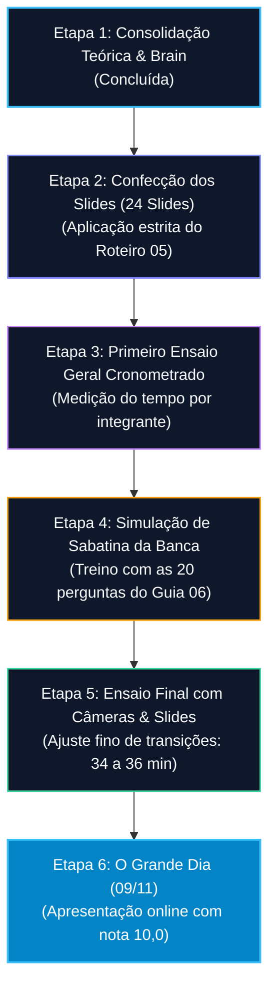

# 07. Checklist Operacional, Cronograma e Plano de Contingência
## Grupo 4 – Tópicos Especiais em Visão Computacional (UFPI / 2026.2)
**Apresentação:** 09/11 (Segunda-feira) – Sessão Online (Grupos 1, 3 e 4)

---

## 1. Cronograma Regressivo de Preparação

| Data / Marco | Atividade / Entregável | Responsáveis | Critério de Sucesso |
| :--- | :--- | :---: | :--- |
| **Fase I** | Conclusão da base de conhecimento (`docs/brain/`). | Trio | 100% dos 8 documentos operacionais criados. |
| **Fase II** | Montagem da apresentação de slides no formato 16:9. | Trio | Slides profissionais sem blocos de texto denso. |
| **Fase III** | Ensaio 1: Cronometragem individual rigorosa. | Trio | Aluno 1: 11 min; Aluno 2: 11 min; Aluno 3: 11 min. |
| **Fase IV** | Ensaio 2: Simulação de sabatina (banca do Prof. Denes). | Trio | Respostas fluentes às perguntas sem hesitações. |
| **Fase V (Véspera)** | Teste de microfones, webcams e compartilhamento. | Trio | Zero falhas técnicas na chamada de teste. |
| **09/11 (Dia D)** | **Apresentação Online Oficial (Grupo 4).** | **Trio** | **Desempenho nota 10,0 (Grupo 5,0 + Individual 5,0).** |
| **12/11 e 16/11** | Presença obrigatória como plateia nos outros grupos. | Trio | Evitar penalidade de -0,5 ponto por falta. |

---

## 2. Checklist de Verificação Passo a Passo

### 2.1. Checklist de Slides e Qualidade Visual (1,25 pts Coletivo)
- [ ] **Proporção 16:9 Widescreen:** Slides configurados no padrão moderno de tela cheia para chamadas online.
- [ ] **Equilíbrio Visual:** Relação de 60% elementos visuais (diagramas, tabelas e gráficos) para 40% texto resumido em tópicos concisos.
- [ ] **Legibilidade:** Fontes sem serifa (ex: Inter, Roboto, Arial) com tamanho mínimo de 18pt para corpo e 28pt para títulos.
- [ ] **Diagramas Arquiteturais:** Fluxogramas da CNN (AlexNet) e do ViT legíveis e em alta resolução.
- [ ] **Normas da SBC:** Referências bibliográficas formais inseridas no slide 22 e citações de rodapé (*et al.*).
- [ ] **Exportação Segura:** Arquivo final salvo simultaneamente em formato PDF (garantia contra desformatação) e PPTX/Google Slides.

### 2.2. Checklist de Cobertura das Seções e Análise Técnica (3,0 pts Coletivo)
- [ ] **Seções Canônicas Contempladas:** Introdução clínica, Trabalhos Relacionados, Metodologia, Experimentos, Resultados e Conclusão presentes em ambos os artigos.
- [ ] **Artigo 1 (CNN Brain Tumor):**
  - [ ] Rótulos incorretos na classe glioma e substituição pelo Figshare explicados.
  - [ ] Hiperparâmetros detalhados: filtros (16, 32, 64), Dropout progressivo ($20\% \to 25\% \to 30\%$), penalidade $L_2$.
  - [ ] Validação cruzada K-Fold (5 folds) e callbacks (Early Stopping e Scheduler).
  - [ ] Tabela com Precisão, Revocação e F1 da classe Glioma (1,00) e global (99%).
  - [ ] Funcionamento do Grad-CAM e teste em base externa (Bhuvaji et al.).
- [ ] **Artigo 2 (ViT Patches Dinâmicos):**
  - [ ] 6 classes do Sistema Bethesda explicadas (ASC-H, ASC-US, HSIL, LSIL, NFIL, SCC).
  - [ ] Dataset CRIC (11.534 núcleos) e estratificação por paciente (anti-leakage).
  - [ ] Balanceamento híbrido com Albumentations (oversampling) e undersampling para 1.000 amostras/classe.
  - [ ] As 5 técnicas dinâmicas explicadas: SR, RA, SS (GrabCut com fallback 10%), ZZ e ES (Espiral).
  - [ ] Tabela 2 de resultados e a vitória do Baseline Grid Conv2D (79% teste / 81% validação).
- [ ] **Capacidade Comparativa e Discussão Crítica (0,75 pt Coletivo):**
  - [ ] Debate explícito sobre Viés Indutivo vs Autoatenção Global.
  - [ ] Explicação do *Data-Hunger* do ViT frente aos 95% do Ensemble de CNNs (Diniz et al.).
  - [ ] Causa física do insucesso dos dinâmicos: sobreposição excessiva de patches ($> 80\%$) e quebra de positional embeddings.
  - [ ] Discussão madura sobre *Slice Leakage* (Artigo 1) vs *Patient Stratification* (Artigo 2).

### 2.3. Checklist Individual de Comunicação e Domínio (5,0 pts Individual)
- [ ] **Tempo Individual Monitorado:** Cada integrante fala entre 10 e 12 minutos.
- [ ] **Terminologia Técnica Apropriada:** Uso consistente de termos como *tokens de patch*, *convolução*, *matriz de confusão*, *overfitting*, *embeddings*, *gradientes*.
- [ ] **Transições Fluidas:** Passagem verbal da palavra ao próximo colega sem hesitação ou silêncio.
- [ ] **Postura em Vídeo:** Câmera ligada com iluminação frontal, fundo neutro e olhar direcionado para a câmera.
- [ ] **Domínio de Sabatina:** Cada integrante leu e domina as perguntas do Guia de Defesa (`06_GUIA_DE_DEFESA_E_PERGUNTAS_BANCA.md`).

---

## 3. Protocolo de Contingência e Gestão de Riscos

| Risco Potencial | Probabilidade | Impacto | Ação de Mitigação Preventiva | Procedimento Imediato se Ocorrer |
| :--- | :---: | :---: | :--- | :--- |
| **Queda de conexão de um integrante durante a apresentação** | Média | Alto | Todos os 3 integrantes devem ter os slides salvos no computador e dominar a fala de todos os blocos. | O colega seguinte assume imediatamente a fala a partir do slide interrompido: *"Dando continuidade à análise que o colega vinha desenvolvendo..."*. |
| **Falha no compartilhamento de tela** | Baixa | Médio | Slides enviados previamente para o Google Drive compartilhado do trio e em PDF local. | Outro integrante assume o compartilhamento em menos de 10 segundos, enquanto o apresentador continua sua fala sem interrupção. |
| **Tempo estourando os 38 minutos** | Média | Crítico | Cronômetro visível com alertas em 10 min (Aluno 1), 21 min (Aluno 2) e 32 min (Aluno 3). | Aluno 3 acelera a fala no Bloco Comparativo, focando diretamente na Matriz Síntese e na Conclusão para fechar em 36 minutos. |
| **Falta de um integrante por motivo de força maior** | Baixa | Extremo | Edital oficial: *"Se um integrante faltar, os demais do grupo devem apresentar a parte do integrante que faltou."* | O trio divide a parte do ausente pela metade: Aluno 1 apresenta Artigo 1 + metade do Artigo 2; Aluno 3 apresenta a outra metade + Discussão Crítica. |
| **Penalidade de presença nas bancas dos outros grupos** | Média | Médio | Falta não justificada acarreta perda de **0,5 ponto (-0,5)** na disciplina. | Todos os integrantes marcam alarmes no celular para os dias **09/11, 12/11 e 16/11**, assistindo com login identificado do início ao fim. |

---

## 4. Submissão Final do Trabalho

Antes de 09/11:
1. Confirmar registro do Artigo 1 e Artigo 2 na planilha oficial do Google Sheets.
2. Salvar os slides finais com a nomenclatura padronizada:  
   `Tópicos_Visão_Computacional_Trabalho_02_Grupo_04.pdf`
3. Enviar cópia via SIGAA ou conforme diretriz do Prof. Dr. José Denes Lima Araújo (`jose.denes@ufpi.edu.br`).
