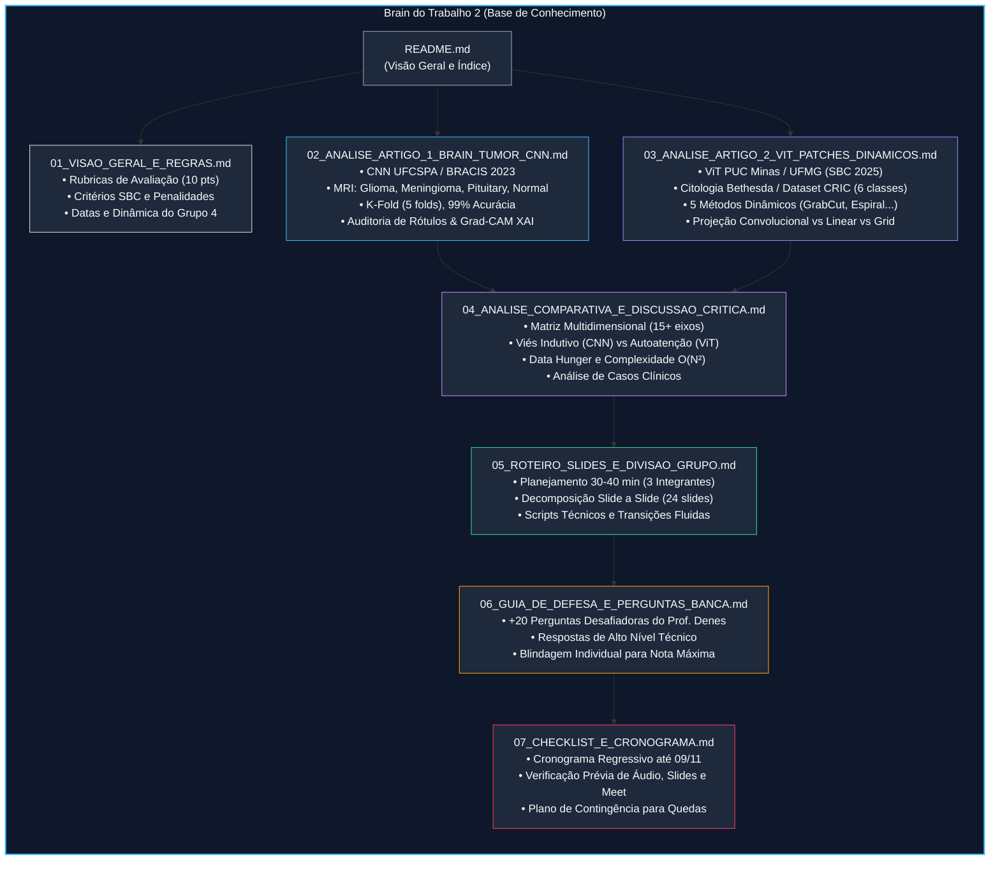

# Base de Conhecimento (Brain) - Trabalho 2: Pesquisa e Análise Crítica de Artigos SBC
## Disciplina: Tópicos Especiais em Visão Computacional (UFPI - 2026.2)
**Docente:** Prof. Dr. José Denes Lima Araújo  
**Discentes:** Grupo 4 (3 Integrantes)  
**Data da Apresentação:** 09/11 (Segunda-feira)  
**Peso da Avaliação:** 10,0 Pontos (5,0 Coletivo / 5,0 Individual)

---

## 1. Visão Geral do Repositório de Conhecimento

Este diretório (`Trabalho 2/docs/brain/`) constitui a **base de conhecimento aprofundada, técnica e estruturada** concebida para respaldar o desenvolvimento dos slides, o alinhamento metodológico do trio e a defesa oral de excelência na disciplina de Tópicos Especiais em Visão Computacional.

O trabalho consiste na pesquisa, desconstrução arquitetural, reprodução analítica e comparação crítica de **dois artigos completos publicados nos anais da Sociedade Brasileira de Computação (SBC)** entre 2022 e 2026, ambos voltados à resolução de problemas desafiadores de **Classificação de Imagens Médicas**:

1. **Artigo 1 (UFCSPA - BRACIS 2023):**  
   *An Approach in Brain Tumor Classification: The Development of a New Convolutional Neural Network Model*  
   **Autores:** Caio dos Santos Felipe, Thatiane Alves Pianoschi Alva, Ana Trindade Winck, Carla Diniz Lopes Becker.  
   **Foco:** Redes Neurais Convolucionais (CNN adaptada da AlexNet), classificação de 4 classes de Ressonância Magnética (MRI) cerebral, validação cruzada 5-fold e explicabilidade via Grad-CAM (99% de acurácia global).

2. **Artigo 2 (PUC Minas / UFMG - SBC 2025):**  
   *Vision Transformers com Patches Dinâmicos para a Análise de Lâminas Histológicas*  
   **Autores:** Vinícius Henrique Giovanini, Alexei Manso Correa Machado.  
   **Foco:** Vision Transformers (ViT-Tiny, ViT-Small, ViT-Base), classificação citopatológica em 6 categorias do Sistema Bethesda (diagnóstico precoce de câncer de colo de útero no dataset CRIC), proposição de 5 técnicas de extração dinâmica de patches (GrabCut, Espiral, Zigue-Zague, etc.) e análise do impacto da projeção convolucional frente ao grid regular.

---

## 2. Mapa Mental e Arquitetura do Brain



---

## 3. Índice Analítico dos Documentos

| Arquivo | Descrição Sintética | Público / Utilidade |
| :--- | :--- | :--- |
| [**01_VISAO_GERAL_E_REGRAS.md**](file:///c:/Users/MWSS/OneDrive/Desktop/Visao%20Computacional/Trabalho%202/docs/brain/01_VISAO_GERAL_E_REGRAS.md) | Detalhamento das diretrizes da UFPI, critérios exatos de pontuação (1,25 / 2,0 / 1,0 / 0,75 no coletivo e 2,0 / 2,0 / 1,0 no individual), regras de presença e cronograma de banca. | Orientação normativa do grupo. |
| [**02_ANALISE_ARTIGO_1_BRAIN_TUMOR_CNN.md**](file:///c:/Users/MWSS/OneDrive/Desktop/Visao%20Computacional/Trabalho%202/docs/brain/02_ANALISE_ARTIGO_1_BRAIN_TUMOR_CNN.md) | Desconstrução minuciosa do artigo de ressonância magnética cerebral: pipeline de dados, correção de anomalias no dataset Kaggle com Figshare, arquitetura camada a camada, regularização L2, Dropout progressivo, K-Fold e mapas de calor Grad-CAM. | Domínio técnico do Artigo 1 (Aluno 1 e grupo). |
| [**03_ANALISE_ARTIGO_2_VIT_PATCHES_DINAMICOS.md**](file:///c:/Users/MWSS/OneDrive/Desktop/Visao%20Computacional/Trabalho%202/docs/brain/03_ANALISE_ARTIGO_2_VIT_PATCHES_DINAMICOS.md) | Análise profunda do artigo de citopatologia cervical: classificação em 6 classes Bethesda, dataset CRIC, divisão por paciente, balanceamento híbrido (oversampling Albumentations + undersampling), os 5 métodos dinâmicos (SR, RA, SS via GrabCut, ZZ, ES), comparação de projeção e a discussão sobre o grid convencional. | Domínio técnico do Artigo 2 (Aluno 2 e grupo). |
| [**04_ANALISE_COMPARATIVA_E_DISCUSSAO_CRITICA.md**](file:///c:/Users/MWSS/OneDrive/Desktop/Visao%20Computacional/Trabalho%202/docs/brain/04_ANALISE_COMPARATIVA_E_DISCUSSAO_CRITICA.md) | Comparação rigorosa cruzada: Paradigma Convolucional vs Self-Attention em Bioimagem, *data-hunger*, invariância translacional, impacto do ruído de fundo, sobreposição de patches, complexidade de inferência e análise do "resultado negativo". | Domínio da discussão crítica (Aluno 3 e grupo). |
| [**05_ROTEIRO_SLIDES_E_DIVISAO_GRUPO.md**](file:///c:/Users/MWSS/OneDrive/Desktop/Visao%20Computacional/Trabalho%202/docs/brain/05_ROTEIRO_SLIDES_E_DIVISAO_GRUPO.md) | Plano mestre da apresentação de 30 a 40 minutos: divisão em 3 blocos equilibrados, tempo por slide, conteúdo visual sugerido, fala recomendada e gatilhos de transição entre os membros. | Roteiro de produção de slides e ensaio. |
| [**06_GUIA_DE_DEFESA_E_PERGUNTAS_BANCA.md**](file:///c:/Users/MWSS/OneDrive/Desktop/Visao%20Computacional/Trabalho%202/docs/brain/06_GUIA_DE_DEFESA_E_PERGUNTAS_BANCA.md) | Arsenal com mais de 20 perguntas técnicas com respostas aprofundadas, cobrindo armadilhas de data leakage, matemática do Grad-CAM, formulação de patches, restrições do GrabCut e trade-offs arquiteturais. | Preparação individual para nota 5,0/5,0. |
| [**07_CHECKLIST_E_CRONOGRAMA.md**](file:///c:/Users/MWSS/OneDrive/Desktop/Visao%20Computacional/Trabalho%202/docs/brain/07_CHECKLIST_E_CRONOGRAMA.md) | Lista de verificação exaustiva de qualidade visual, integridade conceitual, cronograma de ensaios e plano de contingência para o dia 09/11. | Gestão operacional de risco. |

---

## 4. Síntese Executiva dos Artigos Selecionados

> [!IMPORTANT]
> Ambos os artigos cumprem com rigor **100% dos requisitos do edital da disciplina**:
> 1. Artigos completos de conferências nacionais de excelência da SBC (BRACIS 2023 e SBC 2025).
> 2. Janela temporal recente (últimos 5 anos: 2022-2026).
> 3. Foco estrito em **problemas de Classificação em Visão Computacional Médica**.
> 4. Autores e universidades distintas (UFCSPA no RS vs PUC Minas / UFMG em MG).

```
+---------------------------------------------------------------------------------------------------+
|                                 PANORAMA EXECUTIVO COMPARATIVO                                     |
+----------------------------------+--------------------------------+-------------------------------+
| EIXO DE ANÁLISE                  | ARTIGO 1 (UFCSPA - BRACIS 2023)| ARTIGO 2 (PUC/UFMG - SBC 2025)|
+----------------------------------+--------------------------------+-------------------------------+
| Problema Clínico                 | Classificação de Tumor Cerebral| Diagnóstico Câncer Colo Útero |
| Modalidade de Imagem             | Ressonância Magnética (MRI) 2D | Citopatologia / Papanicolau   |
| Classes                          | 4 (Glioma, Meningioma,         | 6 (Bethesda: ASC-H, ASC-US,   |
|                                  | Pituitary, No Tumor)           | HSIL, LSIL, NFIL, SCC)        |
| Dataset Principal                | Kaggle Nickparvar + Figshare   | CRIC (UFOP)                   |
| Resolução de Entrada             | 64 x 64 pixels (RGB normaliz.) | 224 x 224 pixels (recorte)    |
| Arquitetura Proposta             | CNN 3 blocos (AlexNet custom)  | Vision Transformer (ViT-Small)|
| Inovação Metodológica            | Tratamento de rótulos errados, | 5 Métodos de Patches Dinâmicos|
|                                  | K-Fold rigoroso e Grad-CAM XAI | (GrabCut, Espiral, Zigue-Zague)|
| Desempenho Principal             | Acurácia 99% / F1-Score 0.99   | Acurácia 81% Val / 79% Teste  |
| Lição Teórica Chave              | CNN leve atinge convergência   | ViT sofre de data-hunger;     |
|                                  | máxima com forte viés indutivo | Grid regular superou dinâmicos|
+----------------------------------+--------------------------------+-------------------------------+
```

---

## 5. Como Utilizar este Brain Durante os Estudos

1. **Fase 1 - Assimilação Individual:** Cada integrante deve ler com atenção os arquivos [01](file:///c:/Users/MWSS/OneDrive/Desktop/Visao%20Computacional/Trabalho%202/docs/brain/01_VISAO_GERAL_E_REGRAS.md), [02](file:///c:/Users/MWSS/OneDrive/Desktop/Visao%20Computacional/Trabalho%202/docs/brain/02_ANALISE_ARTIGO_1_BRAIN_TUMOR_CNN.md) e [03](file:///c:/Users/MWSS/OneDrive/Desktop/Visao%20Computacional/Trabalho%202/docs/brain/03_ANALISE_ARTIGO_2_VIT_PATCHES_DINAMICOS.md), garantindo compreensão plena dos pipelines.
2. **Fase 2 - Domínio da Discussão Crítica:** O trio deve debater os tópicos do arquivo [04](file:///c:/Users/MWSS/OneDrive/Desktop/Visao%20Computacional/Trabalho%202/docs/brain/04_ANALISE_COMPARATIVA_E_DISCUSSAO_CRITICA.md), compreendendo o motivo pelo qual o ViT não superou a CNN e por que os patches dinâmicos sofreram com sobreposição.
3. **Fase 3 - Montagem dos Slides:** Estruturar a apresentação visual seguindo estritamente as diretrizes de design e divisão de falas do arquivo [05](file:///c:/Users/MWSS/OneDrive/Desktop/Visao%20Computacional/Trabalho%202/docs/brain/05_ROTEIRO_SLIDES_E_DIVISAO_GRUPO.md).
4. **Fase 4 - Simulação de Sabatina:** Praticar as perguntas do arquivo [06](file:///c:/Users/MWSS/OneDrive/Desktop/Visao%20Computacional/Trabalho%202/docs/brain/06_GUIA_DE_DEFESA_E_PERGUNTAS_BANCA.md) em rodadas cruzadas no trio para assegurar a nota máxima individual.
5. **Fase 5 - Fechamento Operacional:** Validar o arquivo [07](file:///c:/Users/MWSS/OneDrive/Desktop/Visao%20Computacional/Trabalho%202/docs/brain/07_CHECKLIST_E_CRONOGRAMA.md) 24 horas antes do dia 09/11.
