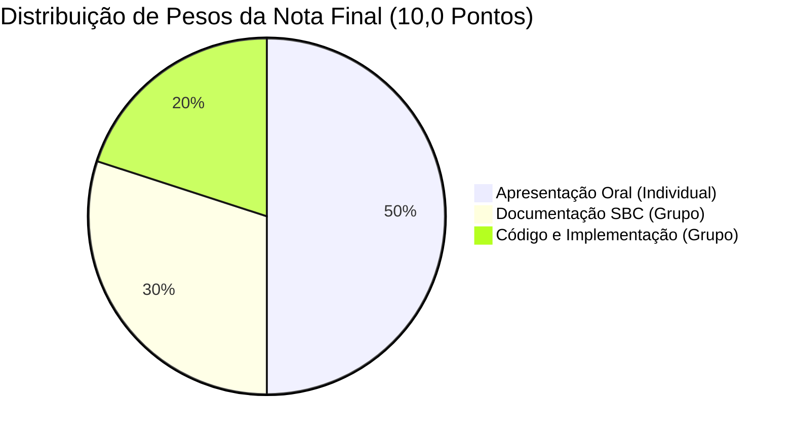

# Visão Geral e Regras Oficiais do Trabalho Final

> **Curso**: Bacharelado em Sistemas de Informação (6º Período - Semestre 2026.2)  
> **Instituição**: Universidade Federal do Piauí (UFPI) — Campus Senador Helvídio Nunes de Barros (Picos)  
> **Disciplina**: Tópicos Especiais em Visão Computacional  
> **Docente**: Prof. Me./Dr. José Denes Lima Araújo (`jose.denes@ufpi.edu.br`)  
> **Grupo Designado**: **Grupo 4** (3 Integrantes)  
> **Data de Apresentação**: **07/12 (segunda-feira)**  
> **Modalidade**: **Modalidade 2 — Reprodução de Artigo Científico**

---

## 1. Introdução e Propósito do Trabalho Final

O Trabalho Final da disciplina de Tópicos Especiais em Visão Computacional (valor total: **10,0 pontos**) tem por finalidade consolidar, aprofundar e aplicar conceitos teóricos e práticos de processamento de imagens digitais e aprendizado profundo (*deep learning*) em problemas reais e desafiadores de alto impacto social e científico.

Na **Modalidade 2 (Reprodução de Artigo Científico)**, o desafio acadêmico consiste em selecionar um artigo científico de visão computacional de alta relevância, reproduzir experimentalmente a metodologia proposta, implementar e adaptar seus módulos computacionais em linguagem Python/PyTorch, comparar os resultados obtidos com os reportados pelos autores originais e conduzir uma análise crítica fundamentada sobre os trade-offs, sucessos e divergências observadas.

> [!IMPORTANT]
> O objetivo central da Modalidade 2 **NÃO É** meramente baixar e executar um repositório pronto ou um script pré-configurado. A avaliação exige a compreensão aprofundada da formulação matemática, a estruturação de código modular próprio ou adaptado, a execução criteriosa de experimentos sob as mesmas métricas e a discussão científica honesta sobre limitações de hardware, hiperparâmetros e divergências estatísticas.

---

## 2. Composição da Avaliação e Rubrica Detalhada

A nota final do Trabalho (10,0 pontos) é distribuída em três eixos independentes, combinando avaliações individuais e em equipe:

### 2.1. Eixo 1: Apresentação Oral — Avaliação Individual (50% da Nota = 5,0 Pontos)

A apresentação será realizada em formato online, com duração estrita entre **20 e 30 minutos** para o grupo de 3 integrantes. Cada membro será avaliado individualmente pelo seu domínio teórico, clareza didática e desenvoltura técnica.

| Critério de Avaliação | Descrição Exigida | Pontuação Máxima |
| :--- | :--- | :---: |
| **Organização, clareza e qualidade visual da apresentação** | Slides bem estruturados, concisos, com alta qualidade visual (sem blocos densos de texto), mapas conceituais, tabelas comparativas legíveis e sequência lógica impecável entre introdução médica, metodologia, experimentos e conclusão. | **1,5 pt** |
| **Domínio do conteúdo e participação equilibrada** | Demonstração clara de conhecimento sobre a formulação matemática (CAMs, WSOD, loss com esparsidade L1), respostas seguras e precisas às perguntas da banca e equilíbrio rigoroso do tempo de fala entre os 3 integrantes (sem sobrecarga de um membro). | **1,5 pt** |
| **Relevância e complexidade do trabalho** | Grau de desafio do problema clínico abordado (detecção de massas em mamografia FFDM de alta resolução), profundidade da reprodução do modelo GMIC e rigor metodológico nos experimentos comparativos. | **1,5 pt** |
| **Postura e atitude profissional** | Pontualidade, postura ética, seriedade acadêmica, comunicação técnica formal e respeito aos colegas e ao docente ao longo de toda a sessão. | **0,5 pt** |
| **Total do Eixo de Apresentação** | — | **5,0 pts** |

---

### 2.2. Eixo 2: Documentação Técnico-Científica — Avaliação em Grupo (30% da Nota = 3,0 Pontos)

Elaboração de um **Relatório Técnico-Científico de 8 a 12 páginas** seguindo estritamente as diretrizes e formatação da Sociedade Brasileira de Computação (SBC). O professor recomenda fortemente o uso de **LaTeX** por meio da plataforma **Overleaf**.

| Critério de Avaliação | Descrição Exigida | Pontuação Máxima |
| :--- | :--- | :---: |
| **Estrutura e organização científica** | Cumprimento exato do formato SBC (template SBC Articles), redação acadêmica impecável, figuras em alta resolução devidamente legendadas e tabelas de métricas padronizadas. | **0,75 pt** |
| **Descrição metodológica clara e detalhada** | Apresentação aprofundada da arquitetura reproduzida (GMIC: ramos Global, Local e Fusão), formulação dos métodos de CAM, descrição do dataset VinDr-Mammo e detalhamento de hiperparâmetros e hardware. | **0,75 pt** |
| **Experimentos e resultados pertinentes** | Protocolo experimental reprodutível, apresentação das métricas de classificação (Acurácia, AUC, TPR, FNR) e detecção (TPR@FPPI com IoU $\ge 0.3$), com comparação direta lado a lado contra o artigo original. | **0,75 pt** |
| **Análise crítica, discussão de limitações e divergências** | Interpretação científica dos resultados, discussão das causas de eventuais discrepâncias (ex.: limitação de VRAM, batch size, seed estocástica), análise do trade-off entre TPR e FPPI e propostas de trabalhos futuros. | **0,75 pt** |
| **Total do Eixo de Documentação** | — | **3,0 pts** |

---

### 2.3. Eixo 3: Código e Implementação — Avaliação em Grupo (20% da Nota = 2,0 Pontos)

O código-fonte deve ser entregue na pasta `Trabalho 3 (Final)/src/`, acompanhado de documentação clara e instruções de execução.

| Critério de Avaliação | Descrição Exigida | Pontuação Máxima |
| :--- | :--- | :---: |
| **Organização e legibilidade do código** | Código modular, estruturado em pacotes/módulos lógicos (`datasets/`, `models/`, `cams/`, `evaluation/`), com funções bem documentadas, tipagem limpa, nomes semânticos e ausência de trechos monolíticos ou redundantes. | **0,5 pt** |
| **Qualidade técnica da implementação** | Precisão algorítmica, eficiência no pipeline de tensores (PyTorch), funcionalidade correta do modelo GMIC, cálculo confiável das perdas multi-ramo com regularização L1, extração de CAMs desacoplados e script de inferência validado. | **1,5 pt** |
| **Total do Eixo de Código** | — | **2,0 pts** |

---

## 3. Cronograma Oficial e Diretrizes de Apresentação

### 3.1. Datas e Escalonamento dos Grupos

As apresentações ocorrerão de modo síncrono e online, obedecendo ao seguinte calendário:

- **07/12 (Segunda-feira)**: Grupos **1**, **3** e **4** (Nosso Grupo!)
- **10/12 (Quinta-feira)**: Grupos **5** e **6**
- **14/12 (Segunda-feira)**: Grupos **8** e **9**

> [!WARNING]
> **Penalidade por Ausência**: É estritamente obrigatório assistir às apresentações dos demais grupos em todos os dias de avaliação. O edital prevê penalização de **-1,0 ponto na nota final** para cada aluno que faltar à sessão de outro grupo sem justificativa formal prévia aceita pela coordenação.

### 3.2. Regras de Participação e Contingência no Trio

1. **Obrigatoriedade Individual**: Todos os 3 integrantes devem apresentar partes equivalentes do conteúdo técnico.
2. **Plano de Ausência de Membro**: Caso um integrante adoeça ou enfrente pane de conexão insuperável, **os outros dois integrantes devem assumir imediatamente a parte do ausente**, sem interrupção do fluxo da apresentação. A nota individual do ausente será tratada separadamente conforme justificativa oficial.
3. **Tempo de Apresentação**: Mínimo de **20 minutos** e máximo de **30 minutos**. O descumprimento dos limites (falar menos de 20 min ou ultrapassar 30 min) acarreta desconto em organização e postura.
4. **Exclusividade do Artigo**: Cada grupo deve reproduzir um artigo exclusivo registrado na planilha oficial da disciplina. Nosso artigo foi devidamente homologado:
   - *A Study on Class Activation Map Methods to Detect Masses in Mammography Images using Weakly Supervised Learning* (Sampaio & Cordeiro, SBC).

---

## 4. Diretrizes Éticas e Políticas de Uso de Inteligência Artificial

O regulamento da disciplina estabelece diretrizes claras sobre a integridade acadêmica:

- **Uso Autorizado**: Ferramentas de IA (como ChatGPT, Claude) podem ser utilizadas **exclusivamente como assistentes de redação e gramática** (função análoga ao *Grammarly*), auxiliando na revisão de clareza, pontuação, concordância verbal e refinamento estilístico de textos previamente escritos pelos estudantes.
- **Uso Proibido**: É expressamente proibido gerar seções inteiras do artigo técnico ou relatórios do zero via IA (*hallucination / zero-shot prompt*). O documento deve refletir o trabalho genuíno do trio, com raciocínio próprio e validação empírica.
- **Rastreabilidade**: O código-fonte deve ser compreendido na íntegra por todos os integrantes. Durante a arguição individual, perguntas detalhadas sobre funções, tensores e parâmetros serão feitas pelo professor.

---

## 5. Checklist de Sucesso para Obtenção de Nota 10,0

Para garantir a nota máxima (10,0 pontos), o Grupo 4 adotará o seguinte padrão de excelência:

- [ ] **Apresentação (5,0 pts)**:
  - Divisão rigorosa de tempo: ~8 minutos por integrante (total de 24 a 26 minutos).
  - Slides profissionais com diagramas conceituais em alta definição (arquitetura GMIC e fluxo dos CAMs).
  - Demonstração visual de heatmaps gerados e bounding boxes preditas vs ground truth verde.
  - Domínio individual absoluto das formulações matemáticas e métricas (IoU, TPR@FPPI).
- [ ] **Documentação SBC (3,0 pts)**:
  - Artigo compilado em LaTeX (Overleaf) respeitando o limite de 8 a 12 páginas.
  - Deduções matemáticas completas do CAM, Grad-CAM, Grad-CAM++, XGrad-CAM e Layer-CAM.
  - Tabela comparativa precisa entre os valores de Sampaio & Cordeiro e os obtidos pelo nosso pipeline.
  - Seção crítica e analítica aprofundada explicando por que o desacoplamento funciona clinicamente.
- [ ] **Código (2,0 pts)**:
  - Estrutura de pastas limpa e modular em `Trabalho 3 (Final)/src/`.
  - Dataloader eficiente do VinDr-Mammo com augmentations.
  - Implementação PyTorch robusta da rede GMIC (ResNet-22 + ResNet-18 + Fusion) com perda combinada.
  - Módulo flexível para troca de CAMs entre treino e teste.
  - Arquivo `requirements.txt` e instruções claras de reprodução no `README.md` do código.
