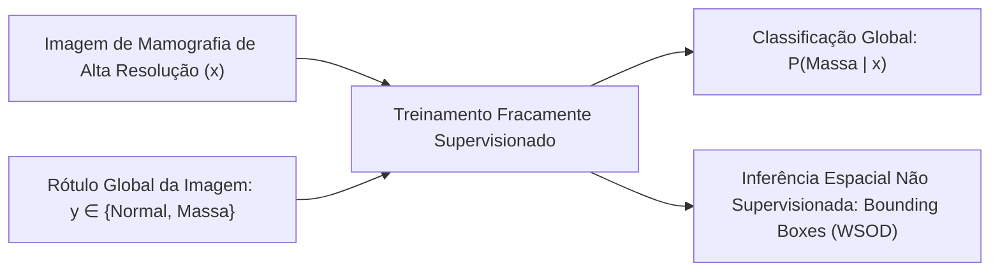
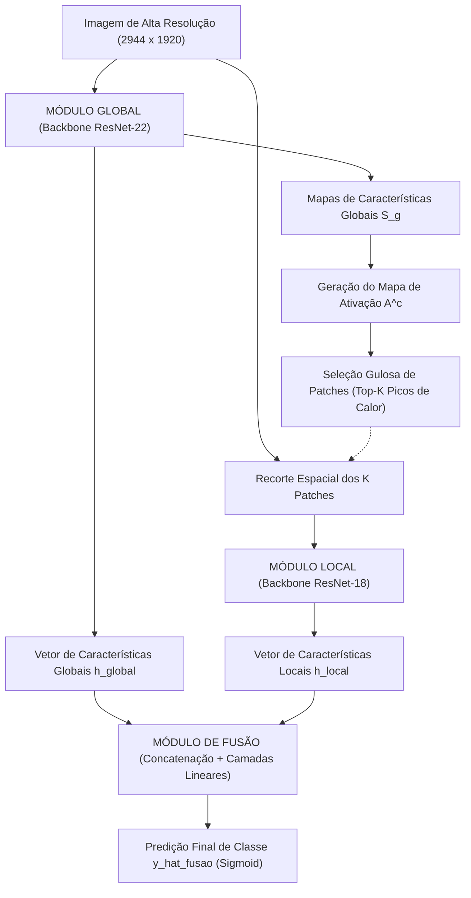
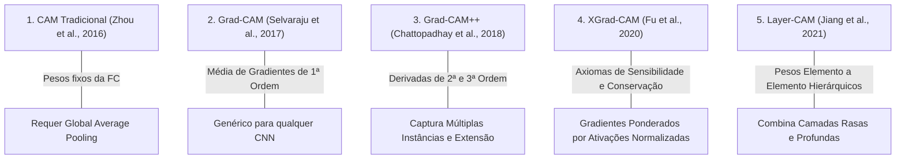
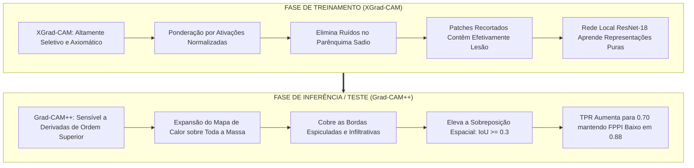

# Análise Aprofundada do Artigo Selecionado: GMIC e WSOD em Mamografia

> **Artigo Analisado**: *"A Study on Class Activation Map Methods to Detect Masses in Mammography Images using Weakly Supervised Learning"*  
> **Autores**: Vicente Sampaio, Filipe R. Cordeiro  
> **Filiação**: Visual Computing Lab, Departamento de Computação, Universidade Federal Rural de Pernambuco (UFRPE)  
> **Publicação**: Anais de Congresso da Sociedade Brasileira de Computação (SBC)  
> **Área**: Visão Computacional Médica, Aprendizado Fracamente Supervisionado (WSOD), Interpretabilidade

---

## 1. Contextualização Clínica e Relevância Social

O câncer de mama permanece como a neoplasia maligna mais incidente e a principal causa de mortalidade por câncer entre a população feminina mundial, respondendo por aproximadamente **15,5% dos óbitos oncológicos em mulheres** (World Health Organization). O prognóstico e a taxa de sobrevida em cinco anos estão diretamente correlacionados ao estadiamento no momento do diagnóstico: tumores detectados em fases iniciais (carcinomas *in situ* ou lesões menores que 10 mm) apresentam taxas de cura superiores a 90%, ao passo que neoplasias em estágios avançados implicam tratamentos invasivos e prognóstico reservado.

A **Mamografia Digital Direta (FFDM - Full-Field Digital Mammography)** é o método padrão-ouro estabelecido internacionalmente para rastreamento populacional (*screening*). Não obstante sua eficácia comprovada, a interpretação radiológica de mamogramas digitais é uma das tarefas mais árduas e complexas da radiologia diagnóstica, decorrente de múltiplos fatores:

1. **Variabilidade Anatômica e Densidade Mamária**: Mamas densas (com predomínio de tecido fibroglandular sobre o adiposo) reduzem a radiotransparência, gerando o fenômeno de "mascaramento", no qual massas e estroma mamário compartilham coeficientes de atenuação radiológica quase idênticos.
2. **Sutileza Morfológica das Lesões**: Massas tumorais malignas frequentemente apresentam bordas espiculadas, microlobuladas ou indistintas, além de dimensões diminutas nos estágios precoces.
3. **Fadiga Humana e Sobrecarga Diagnóstica**: Em programas de rastreamento em massa, cada radiologista avalia centenas de exames diariamente (cada um contendo quatro incidências de altíssima resolução), o que eleva a taxa de falsos negativos (lesões não percebidas) e falsos positivos (biópsias desnecessárias).

Nesse cenário, sistemas de Diagnóstico Auxiliado por Computador (**CAD - Computer-Aided Diagnosis / Detection**) baseados em Aprendizado Profundo (*Deep Learning*) atuam como uma "segunda opinião" automatizada, delimitando regiões suspeitas e auxiliando na redução de omissões diagnósticas.

---

## 2. O Paradigma de Aprendizado Fracamente Supervisionado (WSOD)

### 2.1. O Gargalo da Anotação Totalmente Supervisionada

A abordagem tradicional de detecção de objetos e segmentação semântica (*Fully Supervised Learning*) requer anotações a nível de pixel ou *bounding boxes* delimitadas manualmente por radiologistas certificados para cada imagem do conjunto de treinamento. Na área médica, esse processo apresenta impedimentos críticos:

- **Custo Financeiro e Logístico Proibitivo**: Anotar contornos tumorais em exames de resolução $2944 \times 1920$ consome horas de especialistas qualificados.
- **Variabilidade Inter e Intra-observador**: Radiologistas distintos frequentemente divergem quanto aos limites exatos da fronteira de uma massa espiculada.
- **Escassez de Bases Anotadas**: Embora existam milhões de mamogramas arquivados em hospitais com laudos textuais de presença/ausência de massa, menos de 1% possui máscaras de anotação geométrica.

### 2.2. Formulação Matemática do WSOD

O **Aprendizado Fracamente Supervisionado para Detecção de Objetos (WSOD - Weakly Supervised Object Detection)** busca contornar esse gargalo treinando redes neurais profundas utilizando **apenas o rótulo em nível de imagem** (*image-level label*), sem fornecer nenhuma coordenada espacial durante o treinamento.

Formalmente, dado um conjunto de dados de treinamento $\mathcal{D}_{train} = \{(x_n, y_n)\}_{n=1}^N$, onde:
- $x_n \in \mathbb{R}^{H \times W}$ representa a imagem de mamografia de alta resolução;
- $y_n \in \{0, 1\}$ é o rótulo binário global ($y=0$: exame normal; $y=1$: presença de massa tumoral).

O objetivo é treinar um modelo parametrizado por $\Theta$ capaz de:
1. Predizer a probabilidade da classe da imagem $\hat{y} = P(y=1|x; \Theta)$;
2. Inferir na fase de teste uma coleção de regiões delimitadoras $\mathcal{B} = \{b_k\}_{k=1}^K$ com scores de confiança $s_k$, indicando a localização espacial exata da lesão na imagem, sem que o modelo jamais tenha visto uma caixa delimitadora durante o treino.

---

## 3. Arquitetura GMIC (Globally-Aware Multiple Instance Classifier)

O modelo central estudado por Sampaio & Cordeiro é o **GMIC**, concebido originalmente por Shen et al. (*Medical Image Analysis*, 2021). O GMIC foi projetado especificamente para superar o desafio de processar imagens médicas gigantescas ($> 5$ megapixels) sem perder detalhes de lesões milimétricas nem estourar a memória das GPUs.

A arquitetura organiza-se em três módulos integrados:

### 3.1. Módulo Global (Global Network)
- **Backbone**: ResNet-22 customizada para preservar resolução espacial.
- **Entrada**: Imagem completa de mamografia de alta resolução $x \in \mathbb{R}^{2944 \times 1920 \times 1}$.
- **Processamento**: Extrai tensores de características globais $S_g \in \mathbb{R}^{H_g \times W_g \times C_g}$.
- **Função**: Gera a predição global $\hat{y}^c_{global}$ e produz o **Mapa de Ativação de Classe $A^c \in \mathbb{R}^{H_g \times W_g}$**, que funciona como um mecanismo de atenção visual destacando as coordenadas de maior probabilidade tumoral.

### 3.2. Módulo Local (Local Network)
- **Extração de Patches**: A partir do mapa de ativação $A^c$, aplica-se um algoritmo guloso (*greedy search*) com supressão de vizinhança para encontrar os $K$ picos máximos de ativação.
- **Recorte**: Centrados nesses picos, são recortados $K$ patches de resolução moderada (por exemplo, $256 \times 256$ pixels) diretamente da imagem original de alta resolução $x$.
- **Backbone Local**: Uma ResNet-18 processa individualmente cada patch recortado, extraindo representações convolucionais finas capazes de identificar espículas, bordas microlobuladas e microcalcificações pleomórficas que passariam despercebidas em downsamplings globais.
- **Agregação**: Os vetores de cada patch são agregados via pooling de múltiplas instâncias (MIL), produzindo a representação local $h_{local}$ e a predição local $\hat{y}^c_{local}$.

### 3.3. Módulo de Fusão (Fusion Network)
- Combina a representação contextual de baixo ganho do Módulo Global com os detalhes ultra-resolvidos do Módulo Local.
- Concatena os vetores $[h_{global}; h_{local}]$ e processa-os através de camadas totalmente conectadas (*Fully Connected*) finalizadas com ativação Sigmoid:
  $$\hat{y}^c_{fusao} = \sigma\left(W_f \cdot [h_{global}; h_{local}] + b_f\right)$$

### 3.4. Função de Perda Multi-Ramo e Regularização de Esparsidade L1

Para garantir que todos os ramos convirjam sinergicamente e que o mapa de ativação $A^c$ não se disperse por todo o parênquima mamário sadio, o GMIC otimiza uma função de perda combinada:

$$\mathcal{L}(y, \hat{y}) = \sum_{c \in \{0, 1\}} \left[ \text{BCE}(y^c, \hat{y}^c_{local}) + \text{BCE}(y^c, \hat{y}^c_{global}) + \text{BCE}(y^c, \hat{y}^c_{fusao}) \right] + \beta \mathcal{L}_{reg}(A^c)$$

Onde:
- $\text{BCE}(y, \hat{y}) = - \left[ y \log(\hat{y}) + (1 - y) \log(1 - \hat{y}) \right]$ é a Entropia Cruzada Binária;
- $\mathcal{L}_{reg}(A^c)$ é o **termo de regularização L1** aplicado sobre o mapa de ativação da classe massa:
  $$\mathcal{L}_{reg}(A^c) = \sum_{i=1}^{H_g} \sum_{j=1}^{W_g} |A^c_{i,j}|$$
- $\beta = 3.26$ é o hiperparâmetro empírico calibrado por Shen et al. para penalizar mapas de calor hipertrofiados, forçando a rede a concentrar a ativação estritamente sobre a lesão (promovendo esparsidade espacial).

---

## 4. Estudo Comparativo e Formulação Matemática dos 5 Métodos de Mapas de Ativação (CAM)

A contribuição fulcral de Sampaio & Cordeiro é avaliar sistematicamente o impacto de diferentes técnicas de saliência baseadas em gradiente e ativação quando acopladas ao GMIC, transcendendo o CAM padrão.

### 4.1. CAM (Class Activation Mapping - Zhou et al., 2016)
O método pioneiro requer que a arquitetura finalize com uma camada de Global Average Pooling (GAP) conectada diretamente à camada linear de classificação sem camadas ocultas intermediárias:

$$CAM^c(x, y) = \text{ReLU}\left( \sum_{k=1}^{N_l} w_k^c \cdot A^k(x, y) \right)$$

Onde:
- $A^k(x, y)$ é a ativação espacial do canal $k$ na última camada convolutiva;
- $w_k^c$ é o peso sináptico que conecta a média global do canal $k$ à classe de saída $c$;
- $\text{ReLU}$ assegura que apenas características que exercem influência estritamente positiva sobre a classe alvo sejam visualizadas.

*Limitação em mamografia*: Os mapas resultantes tendem a ser difusos, volumosos e com baixa resolução espacial, cobrindo áreas amplas de tecido normal adjacente.

---

### 4.2. Grad-CAM (Selvaraju et al., 2017)
O Grad-CAM generalizou o CAM para qualquer arquitetura convolucional arbitrária ao calcular os pesos através da média global dos gradientes do score da classe $Y^c$ em relação aos mapas de ativação $A^k$:

$$\alpha_k^c = \frac{1}{Z} \sum_{i=1}^u \sum_{j=1}^v \frac{\partial Y^c}{\partial A_{i,j}^k}$$

$$L_{\text{Grad-CAM}}^c = \text{ReLU}\left( \sum_k \alpha_k^c A^k \right)$$

Onde $Z = u \times v$ representa o número de pixels espaciais do mapa de características.

*Comportamento*: O Grad-CAM gera ativações mais concentradas no "epicentro" da anomalia, porém pode subestimar a borda total em lesões extensas ou infiltrativas.

---

### 4.3. Grad-CAM++ (Chattopadhay et al., 2018)
Desenvolvido especificamente para sanar as deficiências do Grad-CAM em cenários onde múltiplos objetos da mesma classe coexistem ou onde a morfologia do objeto varia em escala. Os pesos dos gradientes $\alpha_{i,j}^{k,c}$ são calculados através de derivadas parciais de ordens superiores (segunda e terceira ordem):

$$w_k^c = \sum_{i=1}^u \sum_{j=1}^v \alpha_{i,j}^{k,c} \cdot \text{ReLU}\left( \frac{\partial Y^c}{\partial A_{i,j}^k} \right)$$

Onde o coeficiente de ponderação analítico $\alpha_{i,j}^{k,c}$ é dado por:

$$\alpha_{i,j}^{k,c} = \frac{\frac{\partial^2 Y^c}{(\partial A_{i,j}^k)^2}}{2 \frac{\partial^2 Y^c}{(\partial A_{i,j}^k)^2} + \sum_{a,b} A_{a,b}^k \frac{\partial^3 Y^c}{(\partial A_{a,b}^k)^3}}$$

*Vantagem diagnóstica*: O Grad-CAM++ pondera com maior precisão cada pixel que contribui positivamente para o diagnóstico, capturando com exatidão a área envolvente e a morfologia irregular das massas mamárias.

---

### 4.4. XGrad-CAM (Axiom-based Grad-CAM - Fu et al., 2020)
O XGrad-CAM introduz uma base axiomática rigorosa para métodos de visualização, formulando os pesos a partir de dois princípios formais: **Sensibilidade** e **Completude/Conservação**. Em vez de uma média aritmética simples, os gradientes são escalados pela ativação normalizada de cada canal:

$$\alpha_k^c = \sum_{i=1}^u \sum_{j=1}^v \left( \frac{A_{i,j}^k}{\sum_{p=1}^u \sum_{q=1}^v A_{p,q}^k} \cdot \frac{\partial Y^c}{\partial A_{i,j}^k} \right)$$

$$L_{\text{XGrad-CAM}}^c = \text{ReLU}\left( \sum_k \alpha_k^c A^k \right)$$

*Propriedade única*: Ao ponderar o gradiente pela magnitude relativa da ativação em cada ponto, o XGrad-CAM suprime gradientes ruidosos em regiões de baixa ativação, gerando mapas limpos, coesos e com baixíssima taxa de falsas ativações espúrias.

---

### 4.5. Layer-CAM (Jiang et al., 2021)
Enquanto a maioria das técnicas foca exclusivamente na camada convolutiva mais profunda (onde a semântica é rica, mas a resolução espacial é grosseira), o Layer-CAM permite extrair e agregar mapas de ativação de camadas rasas e intermediárias:

$$w_{i,j}^k = \text{ReLU}\left( \frac{\partial Y^c}{\partial A_{i,j}^k} \right)$$

$$\hat{M}^k = w^k \odot A^k$$

$$M_{\text{Layer-CAM}}^c = \text{ReLU}\left( \sum_{k=1}^{N_l} \hat{M}_{i,j}^k \right)$$

Onde $\odot$ indica a multiplicação elemento a elemento ponderada no próprio espaço da ativação.

*Resultado empírico*: Embora capture detalhes ultrafinos de bordas, em exames de mamografia o Layer-CAM demonstrou hiper-reatividade a variações fisiológicas de densidade tecidual normal, resultando em um número excessivo de falsos positivos.

---

## 5. O Dataset VinDr-Mammo (Nguyen et al., 2022)

Para a validação experimental, os autores utilizaram a renomada base de dados pública internacional **VinDr-Mammo**:

- **Volume Total**: 5.000 exames mamográficos completos (20.000 imagens FFDM DICOM).
- **Incidências por Exame**: 4 projeções mamográficas padrão:
  - **CC-D**: Craniocaudal da mama direita;
  - **CC-E**: Craniocaudal da mama esquerda;
  - **MLO-D**: Médio-lateral oblíqua da mama direita;
  - **MLO-E**: Médio-lateral oblíqua da mama esquerda.
- **Resolução Nativa**: Média de $2944 \times 1920$ pixels em escala de cinza de 12 a 16 bits.
- **Anotações de Especialistas**: Cada mamograma foi avaliado e anotado de forma independente por radiologistas especialistas certificados, contendo rótulos em nível de imagem e caixas delimitadoras (*bounding boxes*) para anomalias comprovadas.

### 5.1. Protocolo de Filtragem e Balanceamento de Sampaio & Cordeiro
Para viabilizar o estudo controlado de WSOD entre tecido saudável e tecido neoplásico, os autores realizaram a seguinte filtragem:
1. **Definição de Classes**:
   - Classe 0: **Normal** (mamas sem achados radiológicos suspeitos);
   - Classe 1: **Massa** (imagens comprovadamente contendo massas tumorais).
2. **Conjunto de Treinamento**: 1.978 imagens perfeitamente balanceadas (989 normais e 989 com massa).
3. **Conjunto de Teste**: 474 imagens perfeitamente balanceadas (237 normais e 237 com massa).
4. **Isolamento de Supervisão**: A informação de coordenadas de localização (*bounding boxes*) foi completamente omitida durante todo o treinamento, sendo utilizada **exclusivamente na fase de teste** para mensurar o IoU da detecção WSOD.

---

## 6. Métricas de Avaliação e Critérios de Detecção WSOD

### 6.1. Métricas de Classificação (Nível de Imagem)
- **Acurácia (Acc)**: $\frac{VP + VN}{VP + VN + FP + FN}$
- **Sensibilidade / True Positive Rate (TPR)**: $\frac{VP}{VP + FN}$
- **Taxa de Falsos Negativos (FNR)**: $\frac{FN}{VP + FN} = 1 - \text{TPR}$
- **Taxa de Verdadeiros Negativos (TNR)**: $\frac{VN}{VN + FP}$
- **AUC-ROC**: Área sob a curva de sensibilidade vs $(1 - \text{especificidade})$ em múltiplos limiares de probabilidade.

### 6.2. Métricas de Detecção (Nível de Objeto / WSOD)
A validação de localização é executada **estritamente sobre as imagens de teste da classe massa** ($N = 237$). O mapa de ativação 2D gerado pela rede é binarizado através de um limiar $\tau$:

$$\mathcal{M}_{bin}(x, y) = \begin{cases} 1, & \text{se } A^c(x, y) \ge \tau \\ 0, & \text{caso contrário} \end{cases}$$

A partir dos componentes conectados de $\mathcal{M}_{bin}$, são geradas as *bounding boxes* preditas $B_{pred}$.

- **Critério de Acerto Espacial**: Uma predição $B_{pred}$ é classificada como **Verdadeiro Positivo de Localização ($VP_{loc}$)** se a sua **Intersecção sobre a União (IoU)** com a anotação padrão-ouro do especialista ($B_{gt}$) for superior ou igual a 0.3:
  $$\text{IoU}(B_{pred}, B_{gt}) = \frac{\text{Área}(B_{pred} \cap B_{gt})}{\text{Área}(B_{pred} \cup B_{gt})} \ge 0.3$$
- **TPR de Detecção**: Proporção de massas padrão-ouro que foram interceptadas por pelo menos uma bounding box predita com $\text{IoU} \ge 0.3$.
- **FPPI (False Positives Per Image)**: Número médio de caixas delimitadoras preditas errôneas (que não atingem $\text{IoU} \ge 0.3$ com nenhuma lesão real) computadas por imagem de mamografia:
  $$\text{FPPI} = \frac{\sum_{i=1}^{N_{test}} FP_{loc}^{(i)}}{N_{test}}$$

> [!NOTE]
> O valor limiar de $\text{IoU} \ge 0.3$ é o padrão canônico estabelecido na literatura de CAD mamográfico e WSOD médico (Shen et al., Ribli et al.), devido às fronteiras difusas e espiculadas das lesões neoplásicas, que diferem dos contornos rígidos de objetos naturais do dataset PASCAL VOC/COCO.

---

## 7. Análise Crítica dos Resultados do Artigo Original

### 7.1. Desempenho de Classificação Global

Na Tabela 1 do artigo, o GMIC original ajustado sobre a base VinDr-Mammo obteve:

| Modelo | Acurácia (%) | AUC (%) | TPR / Sensibilidade (%) | FNR (%) |
| :--- | :---: | :---: | :---: | :---: |
| **GMIC (Shen et al. / Sampaio & Cordeiro)** | **80,12%** | **87,22%** | **71,88%** | **88,52% (ou TNR)** |

> [!CAUTION]
> **Errata Técnica Identificada no Artigo**: Na Tabela 1 do artigo original, a quarta coluna é nomeada como "FNR" com valor $88.52\%$. No entanto, matematicamente $\text{FNR} = 1 - \text{TPR}$. Se $\text{TPR} = 71.88\%$, o $\text{FNR}$ real é $100 - 71.88 = 28.12\%$. O valor de $88.52\%$ corresponde, na realidade, à **Taxa de Verdadeiros Negativos (TNR / Especificidade)** da rede. Esse ponto é um **diferencial crítico valioso** a ser destacado tanto no Relatório SBC quanto na Apresentação Oral, evidenciando domínio analítico do trio.

---

### 7.2. O Experimento de Desacoplamento Treino/Teste e a Tabela 2

A Tabela 2 do artigo apresenta o resultado central da pesquisa, comparando o desempenho de detecção ($\text{TPR} @ \text{FPPI}$) sob diferentes combinações de mapas de ativação:

| Método de CAM no Treino | Teste: CAM | Teste: GradCAM | Teste: GradCAM++ | Teste: XGradCAM | Teste: LayerCAM |
| :--- | :---: | :---: | :---: | :---: | :---: |
| **GMIC (CAM)** *(Baseline Original)* | 0.69 @ 1.55 | 0.60 @ 0.63 | 0.67 @ 1.43 | 0.68 @ 1.05 | 0.68 @ 1.62 |
| **GMIC (GradCAM++)** | 0.71 @ 2.89 | 0.13 @ 0.06 | 0.65 @ 1.12 | 0.13 @ 0.06 | 0.67 @ 1.59 |
| **GMIC (XGradCAM)** *(Nossa Meta)* | 0.64 @ 0.75 | 0.60 @ 0.43 | **0.70 @ 0.88** 🏆 | 0.60 @ 0.42 | 0.72 @ 4.19 |

---

### 7.3. Por Que o Desacoplamento Funciona? A Teoria Científica do Fenômeno

A análise comparativa revela conclusões científicas profundas que fundamentam a nossa reprodução:

1. **A Função do CAM no Treinamento**:
   No treinamento do GMIC, o mapa de ativação é usado para **recortar patches locais** da imagem de entrada. Se o método de CAM for propenso a espalhar calor em regiões normais (como o CAM clássico ou o Layer-CAM), patches de tecido fibroglandular sadio serão alimentados à ResNet-18 com rótulo "massa". Isso confunde o extrator local com supervisão ruidosa. Ao utilizar **XGrad-CAM no treino**, os patches selecionados são pontuais e precisos, maximizando a pureza dos dados fornecidos à rede local.
2. **A Função do CAM no Teste**:
   Na fase de inferência, o objetivo não é selecionar patches, mas sim maximizar o $\text{IoU} \ge 0.3$ contra o contorno total da lesão demarcada pelo radiologista. O **Grad-CAM++ no teste** pondera positivamente todas as regiões de contorno tumoral, gerando uma máscara expansiva que abrange todo o volume da massa, satisfazendo o limiar de IoU sem incorrer em falsos alarmes em outras regiões da mama.
3. **O Fracasso do Layer-CAM no Teste**:
   O Layer-CAM obteve o maior TPR isolado ($0.72$), porém com um índice de falsos positivos catastrófico de **4.19 FPPI**. Em um contexto clínico de triagem, quatro falsos alarmes por radiografia tornariam o sistema inutilizável, levando à fadiga do radiologista e perda de confiança clínica no software.
