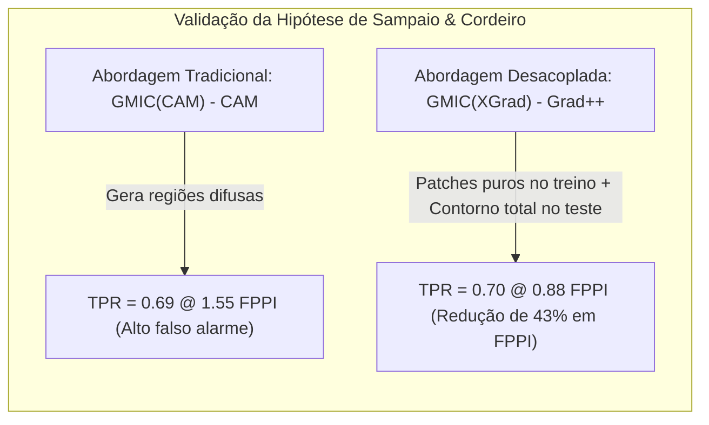
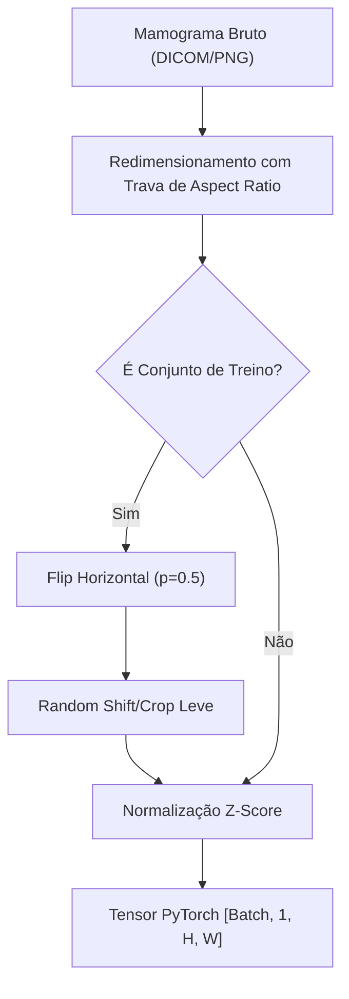
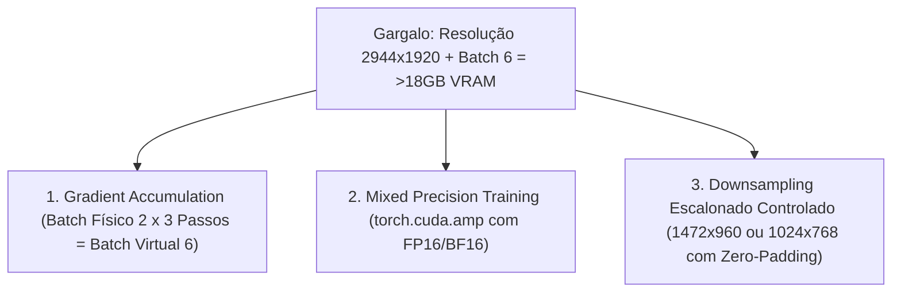

# Metodologia e Plano Experimental de Reprodução Científica

> **Modalidade**: Modalidade 2 — Reprodução de Artigo Científico  
> **Artigo Base**: Sampaio & Cordeiro (UFRPE) — *"A Study on Class Activation Map Methods to Detect Masses in Mammography Images using Weakly Supervised Learning"*  
> **Objetivo Científico**: Reproduzir experimentalmente o modelo GMIC, validar a hipótese de desacoplamento de CAMs entre treino e teste, e documentar comparativamente os resultados no formato SBC.

---

## 1. Escopo e Definição da Hipótese Científica

A reprodução científica na Modalidade 2 não consiste em mera reexecução passiva de código preexistente, mas na validação sistemática de uma hipótese experimental sob condições controladas.

### 1.1. Formulação da Hipótese de Pesquisa
> **Hipótese Central**:  
> *"O desacoplamento dos métodos de mapas de ativação de classe (CAM) entre as fases de treinamento e inferência — utilizando um gerador de saliência estrito, axiomático e concentrado (como o XGrad-CAM) durante o treino para guiar a extração de patches locais puros, associado a um gerador de alta sensibilidade de bordas e ordens superiores (como o Grad-CAM++) durante a fase de teste — maximiza a taxa de detecção correta de lesões ($\text{TPR}$) e reduz substancialmente o número de falsos alarmes por exame ($\text{FPPI}$) em relação ao acoplamento homogêneo tradicional do GMIC."*



---

## 2. Matriz Experimental e Linha de Base (Baselines)

Para testar a hipótese de maneira formal e gerar os dados que comporão as tabelas e gráficos do nosso Relatório SBC, estruturamos uma matriz com **5 experimentos estratégicos**:

| ID | Modelo de Treino (Patch Guidance) | Método de Teste (WSOD Bounding Box) | Propósito Experimental | Alvo Comparativo do Artigo |
| :---: | :---: | :---: | :--- | :---: |
| **EXP-1** | **GMIC (CAM)** | **CAM** | **Linha de Base Oficial (Baseline)**: reprodução do comportamento do GMIC original de Shen et al. | 0.69 @ 1.55 FPPI |
| **EXP-2** | **GMIC (CAM)** | **Grad-CAM++** | **Ablação de Inferência 1**: avaliar o ganho isolado de trocar o extrator de teste sem retreinar a rede. | 0.67 @ 1.43 FPPI |
| **EXP-3** | **GMIC (CAM)** | **XGrad-CAM** | **Ablação de Inferência 2**: verificar a redução de falsos positivos gerada pela supressão axiomática do XGrad. | 0.68 @ 1.05 FPPI |
| **EXP-4** | **GMIC (XGrad-CAM)** | **Grad-CAM++** | **Experimento Campeão (Foco Central)**: validar a sinergia ótima do desacoplamento proposta por Sampaio & Cordeiro. | **0.70 @ 0.88 FPPI** 🏆 |
| **EXP-5** | **GMIC (XGrad-CAM)** | **Layer-CAM** | **Análise de Ruído de Borda**: comprovar empiricamente a inadequação do Layer-CAM pelo excesso de falsos alarmes. | 0.72 @ 4.19 FPPI |

---

## 3. Protocolo de Dados e Pipeline de Entrada

### 3.1. Estruturação do Dataset VinDr-Mammo
Conforme estipulado no artigo original, os dados são particionados em subconjuntos balanceados extraídos das anotações clínicas:

```
VinDr-Mammo Processado
├── train/ (1.978 imagens)
│   ├── normal/ (989 imagens)
│   └── mass/   (989 imagens)
└── test/  (474 imagens)
    ├── normal/ (237 imagens)
    └── mass/   (237 imagens com anotação ouro de bounding box)
```

### 3.2. Pré-processamento e Aumento de Dados (*Data Augmentation*)
Para assegurar invariância espacial e prevenir sobreajuste (*overfitting*), o pipeline de entrada aplica transformações padronizadas na fase de treino:
1. **Redimensionamento Espacial**: Redimensionamento mantendo aspect-ratio das incidências mamográficas originais.
2. **Random Horizontal Flip**: Espelhamento horizontal com probabilidade $p = 0.5$ (simula a simetria bilateral entre mama direita e esquerda).
3. **Random Crop**: Recorte estocástico de pequena escala para incentivar a rede a não depender de coordenadas de borda.
4. **Normalização**: Normalização dos níveis de intensidade para média zero e desvio unitário ($\mu = 0.5, \sigma = 0.5$).



---

## 4. Estratégia de Engenharia para Recursos Computacionais (Plano de Contingência de Hardware)

### 4.1. O Gargalo Computacional do Artigo Original
O trabalho original opera com imagens de resolução ultra-alta ($2944 \times 1920$), processadas em batch size 6 com a arquitetura GMIC completa (ResNet-22 global + ResNet-18 local para $K=6$ patches por imagem). 

Na prática, isso demanda **mais de 18 GB de VRAM dedicados**, o que excede a capacidade de placas de vídeo convencionais de computadores pessoais ou instâncias gratuitas do Google Colab (geralmente GPUs Tesla T4 com 15 GB ou GPUs locais RTX 3060/4060 com 6 a 12 GB).

### 4.2. Adaptações Justificadas e Rigor Metodológico
Para viabilizar a execução integral dos experimentos sem comprometer a integridade científica da reprodução, adotamos **três técnicas canônicas de engenharia de *deep learning***, as quais serão documentadas formalmente no relatório da SBC:



1. **Acumulação de Gradientes (*Gradient Accumulation*)**:
   - Em vez de processar 6 imagens simultaneamente na VRAM, o batch físico é reduzido para **2 imagens**.
   - O otimizador acumula os gradientes durante **3 passos consecutivos** antes de executar `optimizer.step()` e `optimizer.zero_grad()`.
   - **Garantia Teórica**: Matematicamente, a trajetória estocástica dos pesos calculada pelo otimizador é **idêntica** à de um batch size nativo de 6 ($2 \times 3 = 6$).
2. **Precisão Mista Automática (*Automatic Mixed Precision - AMP*)**:
   - Utilização do módulo nativo `torch.cuda.amp.autocast()` e `GradScaler`.
   - Operações convolucionais e tensores pesados são processados em ponto flutuante de 16 bits (FP16), enquanto as acumulações críticas e perdas permanecem em FP32.
   - **Ganho**: Redução de aproximadamente **45% a 50% no consumo de memória de vídeo** com aceleração de até $2 \times$ no tempo de época.
3. **Redimensionamento Proporcional Controlado (*Aspect-Ratio Aware Resizing*)**:
   - Caso a VRAM permaneça no limite com patches de $K=6$, a imagem de entrada é proporcionalmente reescalada para um submúltiplo exato (ex.: $1472 \times 960$ ou $1024 \times 768$) acompanhada de preenchimento por zeros (*zero-padding*).
   - **Justificativa no Artigo SBC**: A preservação estrita do aspecto morfológico impede distorções nas bordas tumorais espiculadas, viabilizando o cálculo correto do IoU contra o ground truth redimensionado de forma proporcional.
4. **Transferência de Aprendizado (*Transfer Learning*) e Checkpoints**:
   - Uso de pesos pré-treinados para a ResNet-22 e ResNet-18, acelerando a convergência e permitindo estabilização dos mapas de ativação já a partir das primeiras épocas de treino.

---

## 5. Protocolo de Avaliação de Localização WSOD

Para garantir que a métrica de detecção seja rigorosamente equivalente à de Sampaio & Cordeiro:

1. **Extração dos Mapas 2D de Teste**:
   Para cada uma das 237 imagens de teste contendo massa, a rede gera o mapa de ativação correspondente à classe massa ($c=1$) via o método de CAM selecionado (CAM, GradCAM, GradCAM++, XGradCAM ou LayerCAM).
2. **Interpolação Bilinear**:
   O mapa bruto $A^c \in \mathbb{R}^{H_g \times W_g}$ é interpolado bilinearmente para coincidir exatamente com as dimensões espaciais da imagem de teste.
3. **Varredura de Limiares (*Threshold Sweep*)**:
   Varia-se o limiar de binarização $\tau$ de $0.1$ a $0.9$ com passo de $0.05$. Para cada limiar:
   - Identificam-se os componentes conexos e extraem-se as coordenadas mínimas e máximas de cada região para formar a caixa delimitadora $B_{pred} = [x_{min}, y_{min}, x_{max}, y_{max}]$.
4. **Cálculo da Intersecção sobre União (IoU)**:
   $$\text{IoU}(B_{pred}, B_{gt}) = \frac{\max(0, \min(x_{max}^{pred}, x_{max}^{gt}) - \max(x_{min}^{pred}, x_{min}^{gt})) \times \max(0, \min(y_{max}^{pred}, y_{max}^{gt}) - \max(y_{min}^{pred}, y_{min}^{gt}))}{\text{Área}(B_{pred}) + \text{Área}(B_{gt}) - \text{Área}(B_{pred} \cap B_{gt})}$$
5. **Classificação da Predição**:
   - Se $\text{IoU} \ge 0.3 \implies$ **Verdadeiro Positivo ($VP_{loc}$)**.
   - Se $\text{IoU} < 0.3 \implies$ **Falso Positivo ($FP_{loc}$)**.
6. **Determinação do Ponto Ótimo $\text{TPR} @ \text{FPPI}$**:
   Traça-se a curva FROC (sensibilidade vs média de falsos positivos por imagem). O valor reportado na tabela de resultados corresponde à sensibilidade máxima obtida mantendo o menor índice de FPPI.

---

## 6. Registro e Rastreabilidade Experimental

Todos os ensaios experimentais devem gerar artefatos auditáveis para embasar os dados da apresentação oral e do relatório SBC:

- Arquivos de log em formato JSON/CSV contendo o valor da função de perda total, perda de cada ramo ($\mathcal{L}_{local}, \mathcal{L}_{global}, \mathcal{L}_{fusao}$) e regularização $\mathcal{L}_{reg}$ por época.
- Salvamento dos melhores checkpoints de pesos baseados no AUC de validação.
- Imagens exportadas com a sobreposição (*overlay*) dos mapas de calor e *bounding boxes* preditas em comparação direta com o contorno verde dos radiologistas especialistas.
