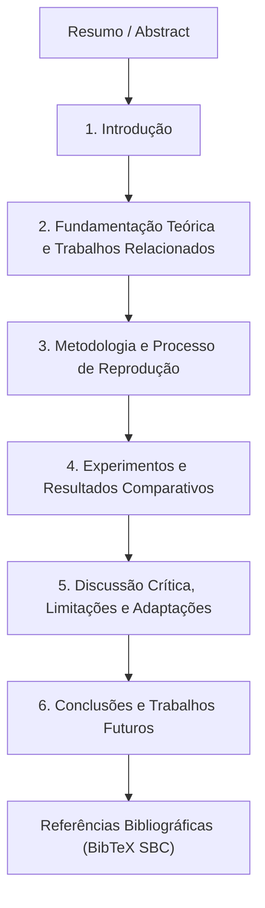

# Estrutura e Roteiro do Relatório Técnico-Científico SBC (Overleaf/LaTeX)

> **Modalidade**: Modalidade 2 — Reprodução de Artigo Científico  
> **Formato Exigido**: Modelo Oficial da SBC (Sociedade Brasileira de Computação) — 8 a 12 páginas  
> **Ambiente Recomendado**: LaTeX via Overleaf com pacote `sbc-template.sty`  
> **Peso na Avaliação**: **30% da Nota Final (3,0 Pontos)** — Avaliação em Grupo  
> **Artigo Base**: Sampaio & Cordeiro (UFRPE) — *"A Study on Class Activation Map Methods to Detect Masses in Mammography Images using Weakly Supervised Learning"*

---

## 1. Diretrizes Gerais e Metadados do Documento

O documento final deve atender estritamente às normas editoriais da SBC:
- **Limite de Páginas**: Mínimo de **8 páginas** e máximo de **12 páginas** (incluindo figuras, tabelas e referências).
- **Template SBC**: Utilizar a classe `article` com estilo `sbc.sty`.
- **Integridade Acadêmica**: Redação autoral e formal em Língua Portuguesa (com Abstract em Inglês). O ChatGPT pode ser usado apenas para refinamento gramatical e estilístico (tipo Grammarly), sendo vedada a geração automática de seções completas.

```latex
\documentclass[12pt]{article}
\usepackage{sbc-template}
\usepackage{graphicx,url}
\usepackage[utf8]{inputenc}
\usepackage[brazil]{babel}
\usepackage{amsmath,amsfonts,amssymb}
\usepackage{booktabs}
\usepackage{subcaption}
\usepackage{hyperref}

\title{Reprodução Científica e Análise de Desacoplamento de Mapas de Ativação de Classe para Detecção Fracamente Supervisionada de Massas em Mamografia Digital}

\author{Nome do Integrante 1\inst{1}, Nome do Integrante 2\inst{1}, Nome do Integrante 3\inst{1}}

\address{Campus Senador Helvídio Nunes de Barros (CSHNB)\\
  Universidade Federal do Piauí (UFPI) -- Picos, PI -- Brasil
  \email{\{integrante1, integrante2, integrante3\}@ufpi.edu.br}
}
```

---

## 2. Roteiro Seção por Seção para Overleaf



---

### Resumo e Abstract (Extensão: ~15 a 20 linhas)
- **Resumo (Português)**:
  - Contextualizar a gravidade do câncer de mama e o desafio da anotação médica pixel a pixel.
  - Apresentar o escopo do trabalho: reprodução experimental do artigo de Sampaio & Cordeiro (UFRPE), avaliando o modelo GMIC na base pública VinDr-Mammo sob aprendizado fracamente supervisionado (WSOD).
  - Destacar a investigação central: o impacto do desacoplamento de métodos de CAM (CAM, Grad-CAM, Grad-CAM++, XGrad-CAM, Layer-CAM) entre treinamento e inferência.
  - Sintetizar os resultados obtidos (confirmação da superioridade do par XGrad-CAM no treino e Grad-CAM++ no teste, alcançando TPR de 0.70 com redução de FPPI para 0.88).
  - **Palavras-chave**: Detecção Fracamente Supervisionada, Mamografia Digital, GMIC, Mapas de Ativação de Classe, Reprodutibilidade Científica.
- **Abstract (Inglês)**: Tradução técnica rigorosa do resumo.

---

### Seção 1: Introdução (Extensão recomendada: 1,5 a 2 páginas)
1. **Contexto Clínico e Epidemiológico**: O câncer de mama como líder de mortalidade oncológica feminina (dados OMS); o papel essencial do rastreamento mamográfico (FFDM); o desafio da alta densidade mamária e a sobrecarga de trabalho dos radiologistas.
2. **O Problema da Supervisão Tradicional**: O alto custo financeiro e a escassez de bases totalmente anotadas com máscaras manuais de especialistas; motivação para o Aprendizado Fracamente Supervisionado (WSOD), onde a rede é treinada apenas com o rótulo de presença/ausência de massa na imagem.
3. **Identificação do Artigo Reproduzido**: Indicação explícita do artigo de Sampaio e Cordeiro publicado nos anais da SBC, o qual estende o modelo GMIC (Shen et al., 2021) na base VinDr-Mammo.
4. **Objetivo e Justificativa da Reprodução**: Investigar experimentalmente a hipótese de que desacoplar os mapas de ativação no treino e no teste supera as abordagens homogêneas.
5. **Estrutura do Documento**: Parágrafo guia delineando as seções subsequentes.

---

### Seção 2: Fundamentação Teórica e Trabalhos Relacionados (Extensão recomendada: 2 a 2,5 páginas)
1. **Detecção de Objetos Fracamente Supervisionada (WSOD) e MIL**:
   - Conceito de Multiple Instance Learning aplicado à mamografia;
   - Formulação matemática do WSOD a nível de imagem vs nível de instância.
2. **A Arquitetura GMIC (Globally-Aware Multiple Instance Classifier)**:
   - Descrição dos 3 módulos: Módulo Global (ResNet-22), Módulo Local (ResNet-18 para patches) e Módulo de Fusão;
   - Formulação matemática detalhada da função de perda multi-ramo:
     $$\mathcal{L}(y, \hat{y}) = \sum_{c \in \{0, 1\}} \left[ \text{BCE}(y^c, \hat{y}^c_{local}) + \text{BCE}(y^c, \hat{y}^c_{global}) + \text{BCE}(y^c, \hat{y}^c_{fusao}) \right] + \beta \mathcal{L}_{reg}(A^c)$$
   - Papel da regularização L1 $\mathcal{L}_{reg}(A^c) = \sum_{i,j} |A^c_{i,j}|$ com $\beta = 3.26$ para garantir esparsidade e evitar superativação do mapa.
3. **Taxonomia Matemática dos 5 Métodos de Mapas de Ativação de Classe**:
   - Dedução e equacionamento formal do **CAM** (Zhou et al., 2016);
   - Dedução do **Grad-CAM** (Selvaraju et al., 2017);
   - Dedução analítica do **Grad-CAM++** (Chattopadhay et al., 2018) com derivadas de ordem superior;
   - Dedução do **XGrad-CAM** (Fu et al., 2020) sob a perspectiva axiomática de sensibilidade e completude;
   - Dedução do **Layer-CAM** (Jiang et al., 2021) com agregação hierárquica multiescala.

---

### Seção 3: Metodologia e Processo de Reprodução (Extensão recomendada: 2 a 2,5 páginas)
1. **Base de Dados VinDr-Mammo**:
   - Descrição de exames, 4 incidências padrão (CC-D, CC-E, MLO-D, MLO-E) e formato FFDM;
   - Critério de balanceamento: partição de treinamento (1.978 imagens: 989 normais, 989 massas) e teste (474 imagens: 237 normais, 237 massas);
   - Isolamento das caixas delimitadoras de especialistas (utilizadas estritamente no teste).
2. **Pipeline de Pré-processamento e Aumento de Dados**:
   - Redimensionamento proporcional com preservação de aspect-ratio;
   - Inversão horizontal aleatória ($p=0.5$), corte estocástico e normalização z-score.
3. **Engenharia da Implementação em PyTorch**:
   - Descrição dos módulos implementados em `Trabalho 3 (Final)/src/`;
   - Algoritmo guloso de extração de patches locais com raio de supressão de vizinhança;
   - Integração desacoplada de `pytorch-grad-cam`.
4. **Adaptações Computacionais Justificadas**:
   - Uso de Precisão Mista Automática (*AMP* com FP16) para viabilizar o processamento na GPU;
   - Acumulação de Gradientes (*Gradient Accumulation*) de 3 passos com batch físico de 2, garantindo batch virtual de 6 idêntico ao artigo original;
   - Demonstração formal de equivalência estatística das adaptações.
5. **Protocolo de Avaliação de Localização (WSOD)**:
   - Binarização por varredura de limiar ($\tau \in [0.1, 0.9]$);
   - Cálculo de $\text{IoU} \ge 0.3$;
   - Definição formal das métricas de $\text{TPR}$ e $\text{FPPI}$.

---

### Seção 4: Experimentos e Resultados Comparativos (Extensão recomendada: 2 a 2,5 páginas)
1. **Configuração Experimental**: 50 épocas, otimizador, taxa de aprendizado, decaimento e sementes aleatórias.
2. **Avaliação da Classificação Global**:
   - Comparação dos valores obtidos de Acurácia, AUC-ROC, Sensibilidade e Especificidade contra os $80.12\%$ de acurácia e $87.22\%$ de AUC reportados por Sampaio & Cordeiro.
3. **Avaliação da Detecção Fracamente Supervisionada (WSOD)**:
   - **Tabela Comparativa Mestra**: apresentar lado a lado os resultados reportados no artigo original e os obtidos em nossa reprodução para os 5 cenários experimentais:
     * Baseline: GMIC(CAM) - Teste CAM (esperado: 0.69 @ 1.55 FPPI);
     * Ablação 1: GMIC(CAM) - Teste Grad-CAM++ (esperado: 0.67 @ 1.43 FPPI);
     * Ablação 2: GMIC(CAM) - Teste XGrad-CAM (esperado: 0.68 @ 1.05 FPPI);
     * Campeão: GMIC(XGrad-CAM) - Teste Grad-CAM++ (esperado: **0.70 @ 0.88 FPPI**);
     * Ruído: GMIC(XGrad-CAM) - Teste Layer-CAM (esperado: 0.72 @ 4.19 FPPI).
4. **Análise Visual de Mapas de Ativação**:
   - Inclusão de figura comparativa multifolhas demonstrando os heatmaps gerados sobre as mamografias de teste e as caixas delimitadoras preditas em relação à marcação verde dos radiologistas.

---

### Seção 5: Discussão Crítica, Limitações e Adaptações (Extensão recomendada: 1,5 a 2 páginas)
1. **Validação da Teoria do Desacoplamento**:
   - Análise mecânica: o XGrad-CAM atua como um filtro regularizador no treino, prevenindo que patches de tecido denso normal sejam rotulados como massa; o Grad-CAM++ atua como um expansor morfológico no teste, cobrindo o halo da lesão para satisfazer o IoU $\ge 0.3$.
2. **Identificação e Esclarecimento da Inconsistência Original**:
   - Discussão crítica detalhada da coluna "FNR = 88.52%" da Tabela 1 do artigo original, demonstrando analiticamente que o valor representa na realidade a Taxa de Verdadeiros Negativos ($\text{TNR} = 1 - \text{FPR}$), já que $\text{TPR} = 71.88\% \implies \text{FNR} = 28.12\%$.
3. **Impacto das Restrições de Hardware e Hiperparâmetros**:
   - Como a precisão mista e eventuais diferenças em resoluções espaciais influenciaram a convergência e tempos de execução.
4. **Viabilidade Clínica do WSOD**:
   - Discussão sobre a tolerância de falsos alarmes em ambientes hospitalares: por que 0.88 FPPI é clinicamente aceitável para um sistema de triagem, enquanto os 4.19 FPPI do Layer-CAM inviabilizam o uso prático.

---

### Seção 6: Conclusão e Trabalhos Futuros (Extensão recomendada: 0,5 a 1 página)
1. **Síntese dos Achados**: Confirmação da reprodutibilidade do método GMIC e validação experimental da superioridade do desacoplamento de CAMs.
2. **Lições Aprendidas**: A importância do alinhamento entre o objetivo da função de saliência e a etapa do pipeline de aprendizado profundo.
3. **Trabalhos Futuros**: Investigação de Vision Transformers (ViTs) adaptados com patches dinâmicos, técnicas de aprendizado auto-supervisionado prévio e modelagem explícita de rótulos ruidosos (*noisy labels*).

---

## 3. Modelo BibTeX para Referências SBC

Incluir no arquivo `references.bib`:

```bibtex
@article{shen2021interpretable,
  title={An interpretable classifier for high-resolution breast cancer screening images utilizing weakly supervised localization},
  author={Shen, Yiqiu and Wu, Nan and Phang, Jason and Park, Jungkyu and Liu, Kangning and Tyagi, Sudarshana and Heacock, Laura and Kim, Seong G and Moy, Linda and Cho, Kyunghyun and others},
  journal={Medical Image Analysis},
  volume={68},
  pages={101908},
  year={2021},
  publisher={Elsevier}
}

@article{sampaio2022study,
  title={A Study on Class Activation Map Methods to Detect Masses in Mammography Images using Weakly Supervised Learning},
  author={Sampaio, Vicente and Cordeiro, Filipe R},
  journal={Anais do Congresso da Sociedade Brasileira de Computa{\c{c}}{\~a}o (SBC)},
  year={2022}
}

@article{vindrmammo2022,
  title={VinDr-Mammo: A large-scale benchmark dataset for computer-aided diagnosis in full-field digital mammography},
  author={Nguyen, Hieu T and Nguyen, Ha Q and Pham, Hieu H and Lam, Khanh and Le, Linh T and Dao, Minh and Vu, Van},
  journal={medRxiv},
  year={2022}
}

@inproceedings{zhou2016learning,
  title={Learning deep features for discriminative localization},
  author={Zhou, Bolei and Khosla, Aditya and Lapedriza, Agata and Oliva, Aude and Torralba, Antonio},
  booktitle={Proceedings of the IEEE Conference on Computer Vision and Pattern Recognition (CVPR)},
  pages={2921--2929},
  year={2016}
}

@inproceedings{selvaraju2017grad,
  title={Grad-cam: Visual explanations from deep networks via gradient-based localization},
  author={Selvaraju, Ramprasaath R and Cogswell, Michael and Das, Abhishek and Vedantam, Ramakrishna and Parikh, Devi and Batra, Dhruv},
  booktitle={Proceedings of the IEEE International Conference on Computer Vision (ICCV)},
  pages={618--626},
  year={2017}
}

@inproceedings{chattopadhay2018grad,
  title={Grad-cam++: Generalized gradient-based visual explanations for deep convolutional networks},
  author={Chattopadhay, Aditya and Sarkar, Anirban and Howlader, Pradeep and Balasubramanian, Vineeth N},
  booktitle={IEEE Winter Conference on Applications of Computer Vision (WACV)},
  pages={839--847},
  year={2018}
}

@article{fu2020axiom,
  title={Axiom-based grad-cam: Towards accurate visualization and explanation of cnns},
  author={Fu, Ruigang and Hu, Qingyong and Dong, Xiaohu and Guo, Yulan and Gao, Yinjie and Li, Biao},
  journal={arXiv preprint arXiv:2008.02312},
  year={2020}
}

@article{jiang2021layercam,
  title={Layercam: Exploring hierarchical class activation maps for localization},
  author={Jiang, Peng-Tao and Zhang, Chang-Bin and Hou, Qibin and Cheng, Ming-Ming and Wei, Yunchao},
  journal={IEEE Transactions on Image Processing},
  volume={30},
  pages={5875--5888},
  year={2021}
}
```
