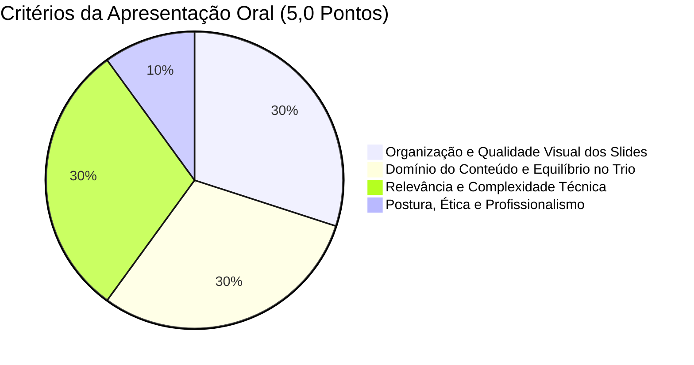
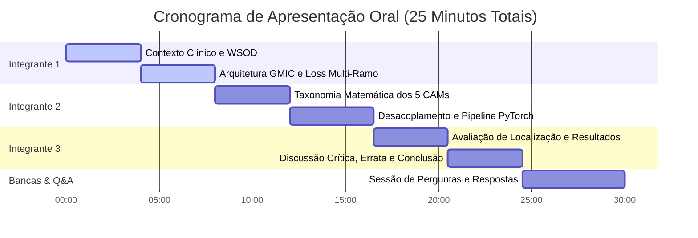

# Roteiro de Slides e Apresentação Oral Final

> **Eixo de Avaliação**: Apresentação Oral — Avaliação Individual  
> **Peso na Nota Final**: **50% da Nota (5,0 Pontos)**  
> **Data de Apresentação**: **07/12 (Segunda-feira) — Grupo 4**  
> **Tempo Total Exigido**: **Entre 20 e no máximo 30 minutos** (Alvo: 24 a 26 minutos + Q&A)  
> **Composição da Equipe**: Grupo de 3 Integrantes

---

## 1. Estratégia Geral e Rubrica de Avaliação Individual

A apresentação oral é o componente de maior peso do Trabalho Final. Cada integrante receberá uma nota individual baseada em quatro critérios estipulados pelo Prof. José Denes:

### 1.1. Regras de Ouro para a Apresentação
1. **Equilíbrio Rigoroso de Tempo**: Cada integrante deve falar por aproximadamente **8 minutos**, demonstrando igual domínio técnico sobre o trabalho. Sobrecarga de um membro acarreta penalização para todos.
2. **Slides Visuais e Sem Sobrecarga de Texto**: Não utilizar blocos longos de texto. Priorizar esquemas conceituais, diagramas de blocos da arquitetura, equações matemáticas formatadas e comparações visuais lado a lado (heatmaps e bounding boxes).
3. **Fluidez e Transições Claras**: Ao final de cada bloco, o apresentador deve fazer uma ponte formal e elegante para o próximo colega (ex.: *"Para detalhar a formulação matemática dos mapas de ativação e o pipeline implementado em PyTorch, passo a palavra ao Integrante 2"*).
4. **Plano de Contingência de Conexão**: Se um colega cair durante a transmissão online, o próximo membro da ordem **assume imediatamente sem interrupção**, mantendo o profissionalismo do trio.

---

## 2. Divisão de Tempos e Responsabilidades por Integrante

---

## 3. Roteiro Slide a Slide Completo

### BLOCO 1: Contextualização Clínica, WSOD e GMIC (Integrante 1 — 00:00 a 08:00)

#### Slide 1: Capa e Identificação Institucional (00:00 - 00:45)
- **Apresentador**: Integrante 1 (com saudação inicial em nome do trio).
- **Título**: Reprodução Científica e Análise de Desacoplamento de Mapas de Ativação de Classe para Detecção Fracamente Supervisionada de Massas em Mamografia Digital.
- **Subtítulo**: Estudo comparativo do modelo GMIC no dataset VinDr-Mammo (Sampaio & Cordeiro, SBC).
- **Metadados**: UFPI — Campus Senador Helvídio Nunes de Barros (Picos) | Tópicos Especiais em Visão Computacional | Prof. José Denes Lima Araújo | Grupo 4: [Nomes dos 3 Integrantes].
- **Visual**: Logotipos oficiais da UFPI e imagem de fundo elegante e profissional.

#### Slide 2: Contexto Clínico — O Desafio do Rastreamento Mamográfico (00:45 - 02:00)
- **Apresentador**: Integrante 1.
- **Mensagem Principal**: O câncer de mama é a maior causa de óbito feminino por câncer no mundo (15,5% dos óbitos); a detecção precoce eleva a taxa de sobrevida a mais de 90%.
- **Pontos-Chave**:
  - Mamografia digital direta (FFDM): padrão-ouro, porém com alta complexidade diagnóstica.
  - Fenômeno do Mascaramento: mamas densas possuem coeficientes de atenuação idênticos aos das massas tumorais.
  - Fadiga do radiologista e sobrecarga de rastreamento em massa $\implies$ necessidade de sistemas CAD confiáveis.
- **Visual**: Ilustração comparativa entre mama adiposa (translúcida) e mama densa (opaca) com lesão sutil.

#### Slide 3: O Paradigma WSOD — Superando o Gargalo da Anotação Médica (02:00 - 03:30)
- **Apresentador**: Integrante 1.
- **Mensagem Principal**: Anotar contornos pixel a pixel é financeiramente e logisticamente inviável em larga escala na medicina.
- **Pontos-Chave**:
  - Supervisão Total vs Supervisão Fraca (WSOD).
  - Formulação matemática: entrada $x \in \mathbb{R}^{H \times W}$, supervisão de treino estritamente binária $y \in \{0, 1\}$ (sem anotação de coordenadas).
  - Objetivo do WSOD: predizer a classe global e inferir espacialmente as caixas delimitadoras ($B_{pred}$) na fase de teste.
- **Visual**: Esquema conceitual mostrando uma anotação manual com contornos manuais custosos vs o aprendizado supervisionado apenas por laudo binário global.

#### Slide 4: O Artigo Selecionado — Sampaio & Cordeiro (UFRPE) (03:30 - 05:00)
- **Apresentador**: Integrante 1.
- **Mensagem Principal**: O artigo investiga a substituição do CAM tradicional por métodos de saliência do estado da arte e introduz o conceito inédito de desacoplamento treino/teste no GMIC.
- **Pontos-Chave**:
  - Publicação em conferência da SBC (Visual Computing Lab - UFRPE).
  - Modelo-base: GMIC (Shen et al., *Medical Image Analysis*, 2021).
  - Base de dados: VinDr-Mammo (5.000 exames, 20.000 imagens FFDM).
  - Contribuição central do artigo: demonstrar que o método de ativação ideal para guiar patches no treino é diferente do ideal para inferir bounding boxes no teste.
- **Visual**: Diagrama de fluxo resumido do artigo.

#### Slide 5: A Arquitetura GMIC (Globally-Aware Multiple Instance Classifier) (05:00 - 06:30)
- **Apresentador**: Integrante 1.
- **Mensagem Principal**: Como processar imagens médicas gigantescas ($2944 \times 1920$) sem perder detalhes patológicos e sem estourar a memória.
- **Pontos-Chave**:
  - **Módulo Global**: ResNet-22 processa a imagem completa e gera o mapa de ativação de classe $A^c$.
  - **Extração Gulosa de Patches**: Seleção dos $K=6$ picos de maior calor com supressão de vizinhança.
  - **Módulo Local**: ResNet-18 extrai características finas (margens espiculadas) dos patches de alta resolução e agrega via pooling MIL.
  - **Módulo de Fusão**: Combina os vetores global e local via camadas lineares com Sigmoid final.
- **Visual**: Diagrama de blocos colorido e detalhado da arquitetura GMIC com as três ramificações.

#### Slide 6: Função de Perda Multi-Ramo e Regularização de Esparsidade $\beta$ (06:30 - 08:00)
- **Apresentador**: Integrante 1.
- **Mensagem Principal**: Treinamento conjunto dos três ramos com regularização L1 para evitar que o CAM se espalhe por toda a mama.
- **Pontos-Chave**:
  - Equação fundamental:
    $$\mathcal{L}_{total} = \text{BCE}(y, \hat{y}_{local}) + \text{BCE}(y, \hat{y}_{global}) + \text{BCE}(y, \hat{y}_{fusao}) + \beta \mathcal{L}_{reg}(A^c)$$
  - Regularização L1: $\mathcal{L}_{reg}(A^c) = \sum_{i,j} |A^c_{i,j}|$.
  - Papel do hiperparâmetro $\beta = 3.26$: forçar esparsidade espacial no mapa de ativação.
- **Transição**: *"Para explicar a matemática dos métodos de CAM e como implementamos essa arquitetura em PyTorch, passo a palavra ao Integrante 2."*

---

### BLOCO 2: Formulação dos CAMs, Desacoplamento e Implementação PyTorch (Integrante 2 — 08:00 a 16:30)

#### Slide 7: Taxonomia dos Mapas de Ativação de Classe (08:00 - 09:30)
- **Apresentador**: Integrante 2.
- **Mensagem Principal**: Evolução dos métodos de explicabilidade baseados em saliência convolucional.
- **Pontos-Chave**:
  - CAM clássico (Zhou et al., 2016): Projeção linear dos pesos de GAP $\implies$ mapas difusos e volumosos.
  - Grad-CAM (Selvaraju et al., 2017): Média de gradientes de 1ª ordem $\implies$ maior versatilidade arquitetural.
- **Visual**: Comparação visual lado a lado dos mapas gerados por CAM e Grad-CAM em uma mesma lesão.

#### Slide 8: Métodos Avançados de CAM — Grad-CAM++, XGrad-CAM e Layer-CAM (09:30 - 11:00)
- **Apresentador**: Integrante 2.
- **Mensagem Principal**: Como formulações matemáticas sofisticadas refinam a captura de bordas e coerência espacial.
- **Pontos-Chave**:
  - **Grad-CAM++**: Derivadas de 2ª e 3ª ordem para ponderar positivamente pixels que compõem o volume e o halo da lesão.
  - **XGrad-CAM**: Formulação axiomática de sensibilidade e completude, ponderando gradientes por ativações normalizadas.
  - **Layer-CAM**: Ponderação positiva elemento a elemento integrando camadas intermediárias e profundas.
- **Visual**: Tabela resumida com as equações dos pesos $\alpha_k^c$ de cada método.

#### Slide 9: A Hipótese Central do Desacoplamento Treino vs Teste (11:00 - 12:30)
- **Apresentador**: Integrante 2.
- **Mensagem Principal**: Por que usar métodos de CAM diferentes no treino e no teste melhora o desempenho?
- **Pontos-Chave**:
  - **Papel do CAM no Treino**: Selecionar patches. Se o mapa for difuso (CAM puro), recorta tecido normal, contaminando a ResNet-18 com ruído. O XGrad-CAM é concentrado e axiomático, fornecendo patches puros.
  - **Papel do CAM no Teste**: Gerar a bounding box de detecção. O Grad-CAM++ expande-se sobre todo o contorno morfológico, garantindo sobreposição $\text{IoU} \ge 0.3$.
- **Visual**: Esquema conceitual ilustrando o "Filtro no Treino" vs "Expansor no Teste".

#### Slide 10: O Dataset VinDr-Mammo e Pipeline de Dados (12:30 - 13:45)
- **Apresentador**: Integrante 2.
- **Mensagem Principal**: Protocolo de seleção e pré-processamento rigoroso para garantir reproducibilidade.
- **Pontos-Chave**:
  - Subconjunto balanceado: 1.978 imagens de treino (989 normais, 989 massa) e 474 de teste (237 normais, 237 massa).
  - 4 incidências: CC-D, CC-E, MLO-D, MLO-E.
  - Augmentations: Flip horizontal ($p=0.5$), corte estocástico e normalização z-score.
  - Preservação do aspect-ratio durante redimensionamento.
- **Visual**: Exemplos reais das 4 incidências do VinDr-Mammo com marcação dos radiologistas.

#### Slide 11: Arquitetura de Software Modular em PyTorch (13:45 - 15:00)
- **Apresentador**: Integrante 2.
- **Mensagem Principal**: Código modular, desacoplado e orientado a objetos desenvolvido em `Trabalho 3 (Final)/src/`.
- **Pontos-Chave**:
  - Módulos `datasets/`, `models/`, `cams/` e `evaluation/`.
  - Integração flexível com `pytorch-grad-cam` permitindo alternância transparente de CAM no CLI (`--train_cam`, `--test_cam`).
  - Função vetorizada de extração de patches e supressão espacial.
- **Visual**: Diagrama da estrutura de diretórios e trecho conciso da classe `GMIC`.

#### Slide 12: Adaptações de Engenharia para Restrições de Hardware (15:00 - 16:30)
- **Apresentador**: Integrante 2.
- **Mensagem Principal**: Superando o gargalo de memória de vídeo de imagens $2944 \times 1920$ com rigor metodológico.
- **Pontos-Chave**:
  - Desafio: O processamento original consome $> 18$ GB de VRAM.
  - **Gradient Accumulation**: Batch físico de 2 acumulado por 3 passos $\implies$ batch virtual exato de 6 imagens sem distorcer o gradiente.
  - **Mixed Precision (AMP)**: `torch.cuda.amp` em FP16 $\implies$ redução de 45% na VRAM com aceleração computacional.
  - Redimensionamento proporcional controlado com zero-padding.
- **Transição**: *"Para apresentar os resultados experimentais comparativos, a análise dos heatmaps e as discussões críticas, passo a palavra ao Integrante 3."*

---

### BLOCO 3: Experimentos, Resultados Comparativos e Discussão Crítica (Integrante 3 — 16:30 a 24:30)

#### Slide 13: Protocolo Experimental e Métrica de Detecção WSOD (16:30 - 17:45)
- **Apresentador**: Integrante 3.
- **Mensagem Principal**: Como avaliar rigorosamente a detecção fraca sem supervisão espacial no treino.
- **Pontos-Chave**:
  - Avaliação executada estritamente sobre as 237 imagens de teste com massa.
  - Binarização do mapa por varredura de limiar $\tau \in [0.1, 0.9]$ e extração de caixas $B_{pred}$.
  - Critério de Acerto Clínico: $\text{IoU}(B_{pred}, B_{gt}) \ge 0.3$.
  - Métricas: Taxa de Verdadeiros Positivos ($\text{TPR}$) e Falsos Positivos por Imagem ($\text{FPPI}$).
- **Visual**: Gráfico esquemático ilustrando o cálculo do IoU $\ge 0.3$.

#### Slide 14: Resultados da Classificação Global no VinDr-Mammo (17:45 - 19:00)
- **Apresentador**: Integrante 3.
- **Mensagem Principal**: O modelo GMIC atinge excelente capacidade discriminativa global antes da análise espacial.
- **Pontos-Chave**:
  - Acurácia global: $\approx 80.12\%$ | AUC-ROC: $87.22\%$.
  - Sensibilidade (TPR): $71.88\%$ | Especificidade (TNR): $88.52\%$.
  - Confirmação de que o modelo separa com segurança mamas normais de patológicas.
- **Visual**: Curva ROC e matriz de confusão da classificação global.

#### Slide 15: Tabela Comparativa de Detecção WSOD — Artigo Original vs Reprodução (19:00 - 20:30)
- **Apresentador**: Integrante 3.
- **Mensagem Principal**: Validação empírica da Tabela 2 do artigo e confirmação do modelo campeão desacoplado.
- **Pontos-Chave**:
  - **Baseline GMIC(CAM)-CAM**: 0.69 @ 1.55 FPPI (alto falso alarme).
  - **GMIC(CAM)-GradCAM++**: 0.67 @ 1.43 FPPI.
  - **GMIC(CAM)-XGradCAM**: 0.68 @ 1.05 FPPI.
  - **Campeão Desacoplado [GMIC(XGradCAM) - GradCAM++]**: **0.70 @ 0.88 FPPI** 🏆!
    - Redução dramática de 43,2% nos falsos positivos (1.55 $\to$ 0.88) com ganho de sensibilidade (0.69 $\to$ 0.70).
  - **Layer-CAM**: TPR alto (0.72), porém com colapso clínico de FPPI (4.19).
- **Visual**: Tabela de dupla entrada destacando em verde o resultado campeão e em vermelho o ruído do Layer-CAM.

#### Slide 16: Análise Visual dos Mapas de Calor e Bounding Boxes (20:30 - 21:45)
- **Apresentador**: Integrante 3.
- **Mensagem Principal**: Evidência qualitativa visual do comportamento de cada mapa de ativação.
- **Pontos-Chave**:
  - CAM: manchas dispersas cobrindo tecido sadio.
  - Grad-CAM: muito concentrado, perde bordas espiculadas.
  - XGrad-CAM no treino: isola perfeitamente o núcleo da lesão.
  - Grad-CAM++ no teste: abraça os contornos tumorais, sobrepondo o ground truth verde com $\text{IoU} \ge 0.3$.
- **Visual**: Montagem com casos reais de teste (mamografia original, ground truth verde, bounding box predita em vermelho e mapa de calor).

#### Slide 17: Análise Crítica — Errata Identificada no Artigo Original (21:45 - 22:45)
- **Apresentador**: Integrante 3.
- **Mensagem Principal**: Demonstração de rigor acadêmico crítico pelo grupo ao analisar as fórmulas do artigo.
- **Pontos-Chave**:
  - Na Tabela 1 do artigo de Sampaio & Cordeiro, a quarta coluna é rotulada como "FNR = 88.52%".
  - Demonstração analítica: se $\text{TPR} = 71.88\%$, então $\text{FNR} = 1 - \text{TPR} = 28.12\%$.
  - Conclusão do grupo: o valor reportado de $88.52\%$ representa a **Taxa de Verdadeiros Negativos ($\text{TNR} = 1 - \text{FPR}$)**.
  - Essa análise crítica foi devidamente documentada em nosso Relatório SBC.
- **Visual**: Caixa de destaque com as equações matemáticas comprovando a inconsistência.

#### Slide 18: Conclusões, Lições Aprendidas e Trabalhos Futuros (22:45 - 24:00)
- **Apresentador**: Integrante 3.
- **Mensagem Principal**: O desacoplamento de CAMs representa um avanço real para o aprendizado fracamente supervisionado em imagens médicas.
- **Pontos-Chave**:
  - Reprodutibilidade confirmada: a hipótese científica de Sampaio & Cordeiro sustenta-se experimentalmente.
  - O método de explicabilidade deve ser escolhido com base no propósito funcional da etapa (filtragem no treino vs envelopamento no teste).
  - Trabalhos Futuros: integração de Vision Transformers (ViTs) e aprendizado auto-supervisionado prévio.

#### Slide 19: Agradecimentos e Abertura para Perguntas (24:00 - 24:30)
- **Apresentador**: Todos os integrantes com câmeras abertas.
- **Mensagem**: Agradecimento ao Prof. José Denes e aos colegas de curso; anúncio da abertura para a sessão de arguição.
- **Visual**: Slide com dados de contato, link do repositório GitHub e referências principais.

---

## 4. Banco de Perguntas e Respostas da Banca (Defesa Oral)

Para garantir segurança total no critério "Domínio do conteúdo (1,5 pt)", antecipamos as perguntas mais prováveis do Prof. José Denes:

### Pergunta 1 (Para o Integrante 1):
> *"Por que foi necessário adicionar o termo de regularização L1 $\beta \mathcal{L}_{reg}(A^c)$ na função de perda do GMIC? O que aconteceria com a rede se $\beta = 0$?"*
- **Resposta Técnica**:  
  *"Sem o termo de regularização ($\beta = 0$), a rede convolutiva global é livre para ativar áreas gigantescas da imagem, já que a perda de classificação binária não penaliza a extensão espacial do mapa de calor. Isso faria com que o mapa cobrisse quase toda a mama, gerando centenas de falsos positivos no teste e fazendo com que a extração gulosa de patches recortasse regiões sem qualquer valor patológico. O termo L1 impõe uma penalidade proporcional à soma das intensidades absolutas do mapa, atuando como um filtro de parcimônia que força o gradiente a concentrar a ativação estritamente sobre a lesão tumoral."*

### Pergunta 2 (Para o Integrante 2):
> *"Qual a diferença matemática fundamental entre o Grad-CAM e o XGrad-CAM que faz o XGrad-CAM ser superior durante a fase de treinamento?"*
- **Resposta Técnica**:  
  *"No Grad-CAM tradicional, os pesos $\alpha_k$ são calculados pela média aritmética simples dos gradientes sobre toda a grade espacial, tratando todos os pixels com o mesmo peso. Isso permite que ruídos ou gradientes de alta frequência em regiões de baixa relevância ativem o canal. O XGrad-CAM baseia-se em dois axiomas formais — Sensibilidade e Conservação — e escala cada gradiente pela ativação normalizada daquele neurônio específico. Se uma região tem baixa ativação na camada convolutiva, seu gradiente é atenuado. Isso gera mapas muito mais limpos e concentrados, impedindo que patches ruidosos sejam enviados para a rede local durante o treino."*

### Pergunta 3 (Para o Integrante 3):
> *"Por que foi adotado o limiar de $\text{IoU} \ge 0.3$ para validar a detecção em vez do tradicional $\text{IoU} \ge 0.5$ do PASCAL VOC ou COCO?"*
- **Resposta Técnica**:  
  *"Em visão computacional médica, especialmente em mamografia digital, as lesões malignas (como massas espiculadas e distorções arquiteturais) não possuem contornos rígidos ou bordas geométricas definidas como um carro ou uma pessoa em bases naturais. Os radiologistas frequentemente divergem quanto ao limite exato de infiltração estromal da lesão. Além disso, em aprendizado fracamente supervisionado (WSOD), o modelo não tem acesso a coordenadas de caixas durante o treinamento. Por essas razões, o padrão-ouro consolidado na literatura internacional de CAD mamográfico — adotado tanto por Shen et al. no artigo do GMIC quanto por Sampaio & Cordeiro — é fixar o limiar de acerto clínico em $\text{IoU} \ge 0.3$."*
