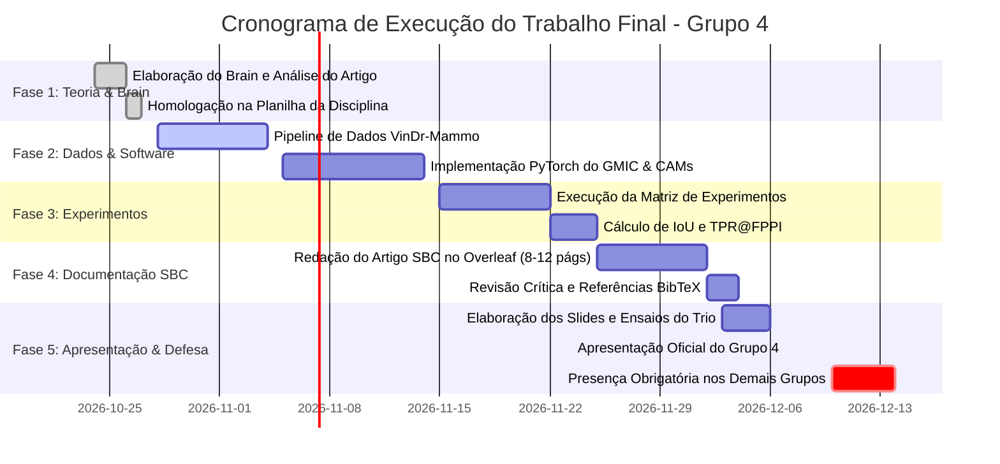

# Checklist Geral e Cronograma Operacional de Entregas

> **Disciplina**: Tópicos Especiais em Visão Computacional (UFPI / 2026.2)  
> **Professor**: José Denes Lima Araújo  
> **Equipe**: **Grupo 4** (3 Integrantes)  
> **Data de Apresentação**: **07/12 (Segunda-feira)** | **Horário**: Sessão Síncrona Online  
> **Datas de Presença Obrigatória**: 07/12, 10/12 e 14/12

---

## 1. Cronograma Integrado de Execução (Rumo à Apresentação em 07/12)

---

## 2. Checklist Detalhado por Componente de Avaliação

### 2.1. Componente 1: Apresentação Oral — Avaliação Individual (50% da Nota = 5,0 Pontos)

| Item | Critério de Aceitação | Responsável | Status |
| :--- | :--- | :---: | :---: |
| **P-01** | Slides criados em proporção 16:9, com identidade visual limpa, diagramas vetoriais da arquitetura GMIC e sem blocos densos de texto. | Trio | [ ] |
| **P-02** | Roteiro estruturado para duração total entre **20 e 30 minutos** (alvo: 24 a 26 minutos + 4 minutos de Q&A). | Trio | [ ] |
| **P-03** | Divisão equilibrada de fala entre os 3 membros: ~8 minutos para cada integrante, sem sobrecarga ou predomínio de um membro. | Trio | [ ] |
| **P-04** | **Integrante 1 afinado**: Contexto clínico, problema do WSOD na mamografia, modelo GMIC e formulação matemática da função de perda com regularização $\beta = 3.26$. | Integrante 1 | [ ] |
| **P-05** | **Integrante 2 afinado**: Taxonomia matemática dos 5 CAMs, proposta de desacoplamento, dataset VinDr-Mammo e arquitetura PyTorch modular com AMP/Gradient Accumulation. | Integrante 2 | [ ] |
| **P-06** | **Integrante 3 afinado**: Protocolo de IoU $\ge 0.3$, resultados de classificação e detecção (TPR@FPPI), análise visual dos heatmaps, discussão da errata da Tabela 1 e conclusão. | Integrante 3 | [ ] |
| **P-07** | Banco de perguntas e respostas da banca estudado por todos os integrantes para a arguição individual. | Trio | [ ] |
| **P-08** | Ensaio geral cronometrado gravado no Google Meet com teste prévio de áudio, câmera e compartilhamento de tela. | Trio | [ ] |
| **P-09** | Plano de contingência de conexão ativo: backup de slides em PDF no celular e rede móvel 4G/5G configurada para tethering imediato. | Trio | [ ] |

---

### 2.2. Componente 2: Documentação Técnico-Científica SBC — Avaliação em Grupo (30% da Nota = 3,0 Pontos)

| Item | Critério de Aceitação | Responsável | Status |
| :--- | :--- | :---: | :---: |
| **D-01** | Projeto configurado no Overleaf utilizando o template oficial da SBC (`sbc-template.sty`). | Trio | [ ] |
| **D-02** | Extensão final do documento rigorosamente entre **8 e 12 páginas** (incluindo figuras, tabelas e referências). | Trio | [ ] |
| **D-03** | Título acadêmico formal, afiliação da UFPI (Picos), nomes dos 3 integrantes, Resumo em Português e Abstract em Inglês. | Trio | [ ] |
| **D-04** | Seção 1 (Introdução) apresentando o problema do câncer de mama, gargalo da supervisão total e identificação formal do artigo de Sampaio & Cordeiro. | Integrante 1 | [ ] |
| **D-05** | Seção 2 (Fundamentação Teórica) com equacionamento formal do GMIC (ramos Global, Local e Fusão), regularização L1 $\beta=3.26$ e dedução matemática dos 5 métodos de CAM. | Integrante 2 | [ ] |
| **D-06** | Seção 3 (Metodologia de Reprodução) descrevendo a partição balanceada do VinDr-Mammo (1.978 treino / 474 teste), augmentations, implementação PyTorch e justificativas técnicas para AMP e Gradient Accumulation. | Integrante 2 | [ ] |
| **D-07** | Seção 4 (Resultados Experimentais) contendo a **Tabela Comparativa Mestra** (Resultados Originais vs Reprodução) para os 5 experimentos, métricas de classificação e painel de figuras comparando heatmaps contra anotações ouro verdes. | Integrante 3 | [ ] |
| **D-08** | Seção 5 (Discussão Crítica) analisando por que o desacoplamento funciona, discutindo a inconsistência técnica identificada na coluna FNR da Tabela 1 e a viabilidade clínica do WSOD. | Integrante 3 | [ ] |
| **D-09** | Seção 6 (Conclusão) e Referências Bibliográficas completas no padrão SBC (`references.bib`). | Trio | [ ] |
| **D-10** | Revisão gramatical e de clareza do texto (ChatGPT utilizado estritamente como revisor estilístico/Grammarly, em total conformidade com as diretrizes éticas). | Trio | [ ] |

---

### 2.3. Componente 3: Código e Implementação — Avaliação em Grupo (20% da Nota = 2,0 Pontos)

| Item | Critério de Aceitação | Responsável | Status |
| :--- | :--- | :---: | :---: |
| **C-01** | Estrutura modular criada em `Trabalho 3 (Final)/src/` com diretórios `configs/`, `datasets/`, `models/`, `cams/` e `evaluation/`. | Trio | [ ] |
| **C-02** | `datasets/vindr_dataset.py`: PyTorch Dataset robusto, com leitura de imagens de mamografia, isolamento de labels no treino e inclusão de ground truth apenas no teste. | Integrante 2 | [ ] |
| **C-03** | `models/gmic.py`: Implementação modular do GMIC contendo ResNet-22 global, extrator guloso de patches locais com supressão de vizinhança, ResNet-18 local e rede de fusão. | Integrante 2 | [ ] |
| **C-04** | `models/losses.py`: Função de perda combinada (3 ramos de BCE) + regularização de esparsidade L1 ponderada por $\beta = 3.26$. | Integrante 1 | [ ] |
| **C-05** | `cams/cam_manager.py`: Módulo desacoplado com interface para os 5 métodos (CAM, Grad-CAM, Grad-CAM++, XGrad-CAM, Layer-CAM) via `pytorch-grad-cam`. | Integrante 2 | [ ] |
| **C-06** | `evaluation/detection_eval.py`: Implementação do pipeline de binarização por limiar, connected components e cálculo vetorizado de $\text{IoU} \ge 0.3$, TPR e FPPI. | Integrante 3 | [ ] |
| **C-07** | `train.py` e `test.py`: Scripts funcionais de linha de comando com argumentos legíveis (`--train_cam`, `--test_cam`, `--amp`, `--accum_steps`). | Trio | [ ] |
| **C-08** | `requirements.txt` atualizado e testado em ambiente virtual Python limpo. | Trio | [ ] |
| **C-09** | `README.md` detalhado em `src/` documentando como configurar o ambiente, baixar os dados, rodar o treinamento e reproduzir a matriz de testes. | Trio | [ ] |

---

### 2.4. Componente 4: Presença Obrigatória e Assiduidade Institucional

> [!CAUTION]
> **Atenção às Datas**: A falta em qualquer sessão de apresentação de outros grupos gera desconto automático de **-1,0 ponto** na nota final da disciplina.

- [ ] **07/12 (Segunda-feira)**: Apresentação do **Grupo 4** e assistência integral às apresentações dos Grupos 1 e 3.
- [ ] **10/12 (Quinta-feira)**: Assistência integral às apresentações dos Grupos 5 e 6.
- [ ] **14/12 (Segunda-feira)**: Assistência integral às apresentações dos Grupos 8 e 9.

---

## 3. Resumo de Atribuições da Equipe (Grupo 4)

| Membro | Foco Principal na Implementação | Foco Principal no Relatório SBC | Bloco de Apresentação Oral |
| :--- | :--- | :--- | :--- |
| **Integrante 1** | Modelagem da Loss GMIC ($\beta=3.26$) e Dataloader base | Seção 1 (Introdução) e Seção 2 (Fundamentação Teórica) | **Bloco 1 (00:00 - 08:00)**: Contexto clínico, WSOD, modelo GMIC e Loss |
| **Integrante 2** | Arquitetura GMIC PyTorch, CAM Manager e AMP/Grad Accum | Seção 2 (CAMs) e Seção 3 (Metodologia e Software) | **Bloco 2 (08:00 - 16:30)**: Taxonomia CAMs, Desacoplamento, VinDr e Código |
| **Integrante 3** | Pipeline de Avaliação WSOD (IoU $\ge 0.3$, TPR@FPPI) | Seção 4 (Resultados) e Seção 5 (Discussão Crítica) | **Bloco 3 (16:30 - 24:30)**: Resultados, Comparativo, Errata e Conclusão |
| **Trio** | Execução de experimentos e revisão de código | Abstract, Conclusão, Revisão geral SBC e BibTeX | **Q&A (24:30 - 30:00)**: Defesa conjunta das perguntas da banca |
