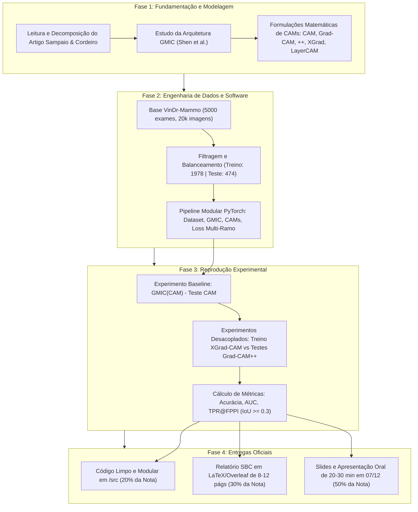

# Brain do Trabalho Final — Tópicos Especiais em Visão Computacional (UFPI)

> **Disciplina**: Tópicos Especiais em Visão Computacional (Período: 2026.2)  
> **Instituição**: Universidade Federal do Piauí (UFPI) — Campus Senador Helvídio Nunes de Barros (Picos)  
> **Docente**: Prof. Me./Dr. José Denes Lima Araújo  
> **Grupo de Apresentação**: **Grupo 4** (3 integrantes)  
> **Data da Apresentação**: **07/12 (Segunda-feira)** | **Tempo**: 20 a 30 minutos (Online)  
> **Modalidade Escolhida**: **Modalidade 2 — Reprodução de Artigo Científico**  
> **Artigo Selecionado**: *"A Study on Class Activation Map Methods to Detect Masses in Mammography Images using Weakly Supervised Learning"* (Vicente Sampaio & Filipe R. Cordeiro — UFRPE, SBC)

---

## 1. Visão Geral do Repositório Brain

Este diretório (`Trabalho 3 (Final)/docs/brain/`) constitui a **base de conhecimento canônica, estratégica e técnica** para a execução do Trabalho Final. Ele consolida todo o referencial teórico-metodológico, a formulação matemática, o planejamento arquitetural de software em PyTorch, a estrutura do artigo científico no formato SBC (8 a 12 páginas em LaTeX/Overleaf), o roteiro detalhado da apresentação oral para o trio e os planos de contingência de hardware e riscos.

```
Trabalho 3 (Final)/docs/brain/
├── README.md                                        # Este arquivo (Índice Mestre & Mapa Mental)
├── 01_VISAO_GERAL_E_REGRAS_TRABALHO_FINAL.md        # Regras, rubrica de avaliação e diretrizes institucionais
├── 02_ANALISE_DO_ARTIGO_SELECIONADO_GMIC_WSOD.md    # Análise matemática e conceitual aprofundada do artigo
├── 03_METODOLOGIA_E_PLANO_DE_REPRODUCAO.md          # Metodologia experimental, hipóteses e baselines
├── 04_ARQUITETURA_DO_CODIGO_E_GUIA_DE_IMPLEMENTACAO.md # Engenharia de software PyTorch, pipeline modular e requirements
├── 05_ESTRUTURA_E_ROTEIRO_RELATORIO_SBC.md          # Roteiro seção por seção do artigo SBC (8-12 págs LaTeX)
├── 06_ROTEIRO_SLIDES_E_APRESENTACAO_FINAL.md        # Roteiro de slides, tempos e divisão equilibrada para 3 integrantes
├── 07_ANALISE_DE_RISCOS_E_PLANO_DE_CONTINGENCIA.md  # Gestão de riscos de VRAM, GPU, convergência e contingências
└── 08_CHECKLIST_GERAL_E_CRONOGRAMA_FINAL.md         # Checklist operacional de entregas e cronograma até 07/12
```

---

## 2. Mapa Mental e Fluxo de Execução do Projeto

O fluxo de trabalho foi estruturado de forma a integrar os três pilares de avaliação definidos pelo professor José Denes: **Apresentação (50%)**, **Artigo Técnico-Científico SBC (30%)** e **Código Implementado (20%)**.



---

## 3. Resumo Executivo dos Guias do Brain

| Arquivo | Tópico Principal | Conteúdo-Chave |
| :--- | :--- | :--- |
| [**01_VISAO_GERAL_E_REGRAS_TRABALHO_FINAL.md**](file:///c:/Users/MWSS/OneDrive/Desktop/Visao%20Computacional/Trabalho%203%20(Final)/docs/brain/01_VISAO_GERAL_E_REGRAS_TRABALHO_FINAL.md) | Regras e Rubricas | Detalhamento dos critérios (50% oral, 30% SBC, 20% código), penalidades, prazos, exigências da Modalidade 2 e regras de IA. |
| [**02_ANALISE_DO_ARTIGO_SELECIONADO_GMIC_WSOD.md**](file:///c:/Users/MWSS/OneDrive/Desktop/Visao%20Computacional/Trabalho%203%20(Final)/docs/brain/02_ANALISE_DO_ARTIGO_SELECIONADO_GMIC_WSOD.md) | Artigo Selecionado | Dedução matemática dos 5 CAMs, arquitetura GMIC (Global ResNet-22, Local ResNet-18, Fusão, perda com regularização L1 $\beta=3.26$), dataset VinDr-Mammo e resultados do artigo. |
| [**03_METODOLOGIA_E_PLANO_DE_REPRODUCAO.md**](file:///c:/Users/MWSS/OneDrive/Desktop/Visao%20Computacional/Trabalho%203%20(Final)/docs/brain/03_METODOLOGIA_E_PLANO_DE_REPRODUCAO.md) | Plano Metodológico | Hipótese científica do desacoplamento, matriz de experimentos (baselines vs combinados), protocolo de avaliação (IoU $\ge 0.3$) e justificativas técnicas. |
| [**04_ARQUITETURA_DO_CODIGO_E_GUIA_DE_IMPLEMENTACAO.md**](file:///c:/Users/MWSS/OneDrive/Desktop/Visao%20Computacional/Trabalho%203%20(Final)/docs/brain/04_ARQUITETURA_DO_CODIGO_E_GUIA_DE_IMPLEMENTACAO.md) | Engenharia PyTorch | Arquitetura modular de diretórios em `src/`, classes PyTorch do GMIC, gerador de CAMs com `pytorch-grad-cam`, treinamento multi-loss, scripts de avaliação e `requirements.txt`. |
| [**05_ESTRUTURA_E_ROTEIRO_RELATORIO_SBC.md**](file:///c:/Users/MWSS/OneDrive/Desktop/Visao%20Computacional/Trabalho%203%20(Final)/docs/brain/05_ESTRUTURA_E_ROTEIRO_RELATORIO_SBC.md) | Artigo SBC LaTeX | Roteiro estruturado de 8 a 12 páginas em LaTeX/Overleaf, modelo de tabelas comparativas, figuras de calor, equações matemáticas e referências BibTeX no padrão SBC. |
| [**06_ROTEIRO_SLIDES_E_APRESENTACAO_FINAL.md**](file:///c:/Users/MWSS/OneDrive/Desktop/Visao%20Computacional/Trabalho%203%20(Final)/docs/brain/06_ROTEIRO_SLIDES_E_APRESENTACAO_FINAL.md) | Apresentação Oral | Roteiro de 20 a 30 minutos dividido em 3 integrantes com equilíbrio perfeito, estrutura de slides, transições, scripts de fala e banco de perguntas e respostas da banca. |
| [**07_ANALISE_DE_RISCOS_E_PLANO_DE_CONTINGENCIA.md**](file:///c:/Users/MWSS/OneDrive/Desktop/Visao%20Computacional/Trabalho%203%20(Final)/docs/brain/07_ANALISE_DE_RISCOS_E_PLANO_DE_CONTINGENCIA.md) | Riscos & Mitigações | Soluções para restrição de VRAM (imagens $2944 \times 1920$), Gradient Accumulation, Mixed Precision FP16, convergência de pesos pré-treinados e contingências online. |
| [**08_CHECKLIST_GERAL_E_CRONOGRAMA_FINAL.md**](file:///c:/Users/MWSS/OneDrive/Desktop/Visao%20Computacional/Trabalho%203%20(Final)/docs/brain/08_CHECKLIST_GERAL_E_CRONOGRAMA_FINAL.md) | Checklist & Cronograma | Cronograma passo a passo até 07/12, checklist de conformidade dos 3 componentes de avaliação e controle de entregáveis. |

---

## 4. Glossário Técnico e Notações do Projeto

- **FFDM (Full-Field Digital Mammography)**: Mamografia digital direta em altíssima resolução ($2944 \times 1920$), padrão ouro para rastreamento de lesões mamárias.
- **WSOD (Weakly Supervised Object Detection)**: Detecção de objetos treinada apenas com anotações a nível de imagem ($y \in \{0, 1\}$, normal vs lesão), sem anotações de localização no treino.
- **GMIC (Globally-Aware Multiple Instance Classifier)**: Arquitetura proposta por Shen et al. (Medical Image Analysis, 2021) composta por Módulo Global, Módulo Local de Patches e Módulo de Fusão.
- **CAM (Class Activation Map)**: Técnica de projeção linear dos pesos da camada densa final sobre os mapas convolucionais após Global Average Pooling (Zhou et al., 2016).
- **Grad-CAM**: Generalização do CAM usando gradientes médios da classe em relação aos canais da última camada convolutiva (Selvaraju et al., 2017).
- **Grad-CAM++**: Extensão que utiliza derivadas de segunda e terceira ordem para capturar múltiplas ocorrências e gradientes ponderados (Chattopadhay et al., 2018).
- **XGrad-CAM (Axiom-based Grad-CAM)**: Variante fundamentada em axiomas de sensibilidade e conservação com gradientes ponderados por ativações normalizadas (Fu et al., 2020).
- **Layer-CAM**: Método que gera mapas densos combinando ponderações positivas elemento a elemento de camadas intermediárias e profundas (Jiang et al., 2021).
- **IoU (Intersection over Union)**: Razão entre a área de intersecção e a área de união entre a bounding box predita e o ground truth de especialistas médicos ($\text{IoU} \ge 0.3$ define um acerto de localização no artigo).
- **TPR (True Positive Rate / Sensibilidade)**: Proporção de lesões verdadeiras detectadas com sucesso ($\text{TPR} = \frac{VP}{VP + FN}$).
- **FPPI (False Positives Per Image)**: Número médio de bounding boxes falsas detectadas por imagem de teste ($\text{FPPI} = \frac{\sum FP}{N_{\text{imagens}}}$).
- **Desacoplamento Treino/Teste**: Inovação de Sampaio & Cordeiro onde um método de CAM estrito e focado (XGrad-CAM) é usado no treino para guiar o extrator local sem ruído, e um método abrangente (Grad-CAM++) é usado no teste para englobar a extensão total da massa tumoral.

> [!IMPORTANT]
> **Data Crítica**: O Grupo 4 apresenta no dia **07/12 (segunda-feira)**. A presença em todas as apresentações dos demais grupos é obrigatória sob pena de perda de 1,0 ponto por falta não justificada.
